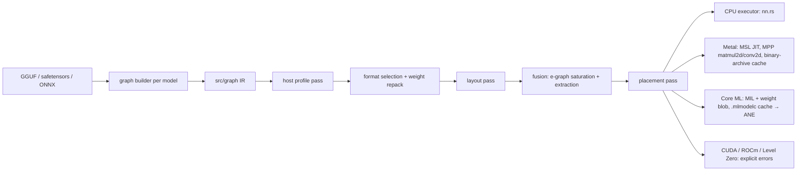

# Gibbs acceleration plan

Goal: run every pipeline (LLM, System 1, SD 2.1 Turbo, ModelScope T2V) on CPU, Metal GPU, and the
Apple Neural Engine, compiled for the host it runs on, with megakernels wherever the hardware can run
them safely. CUDA, ROCm, and Level Zero exist as backends that return an explicit error until hardware
is available to build and verify them.

## Measured on this host (Apple M5 Pro, macOS 26.7.1)

Throwaway probes in `/tmp/mpp-probe` (outside the repo).

| Probe | Result |
| :--- | :--- |
| Host features | CPU 5P+10E cores, NEON, I8MM, BF16, SME2. GPU 16 cores (`gpu-core-count`). No offline `metal` compiler (Command Line Tools only). |
| M5 GPU neural accelerators | MSL 4.0 kernel with `MetalPerformancePrimitives` `matmul2d`, compiled at runtime by `newLibraryWithSource` (metal 0.33 + raw `setLanguageVersion:`), plain buffers wrapped as `tensor_inline`. 256×256×512 half GEMM: max abs err 6.7e-6 vs CPU. **Verified on M5 only.** `convolution2d` (NHWC activations, HWCO weights, full-threadgroup scope) ships in the same headers. |
| ANE via Core ML, no Python | MIL protobuf hand-encoded in Rust → `.mlpackage` → `compileModelAtURL` (61–359 ms) → `cpuAndNeuralEngine`. `MLComputePlan`: 8 conv + 8 relu on `MLNeuralEngineComputeDevice`; max abs err 6.1e-4; 241 µs vs 399 µs CPU-only. A rank-2 `linear` was placed on CPU: graphs must use `[1,C,1,S]` + 1×1 conv. No new crates: `metal::objc` re-export, hand-rolled global Objective-C block, CoreML linked as a system framework. |
| Persistent kernel with a grid barrier | Correct (0 visibility mismatches) up to 192 threadgroups × 256 threads; at 208 they are not all co-resident and the bounded spin aborted cleanly. Barrier 0.8–3.3 µs (grows with threadgroup count) vs dispatch boundary 1.6–2.7 µs. |

## Architecture

### Host profile pass

Runs once per host and caches to `~/.cache/gibbs/host/<device>-<os-build>.json`; re-runs when the
OS build or device changes.

- Static: CPU features (NEON, I8MM, BF16, SME2), core counts, memory; GPU family, MPP availability
  (compile probe), threadgroup memory; ANE availability (Core ML compile probe).
- Measured: dispatch-boundary cost, grid-barrier cost, co-residency limit per persistent kernel
  (bounded-spin binary search, launched with a safety margin), GEMM/conv tile autotuning per shape
  class, CPU vs GPU vs ANE time per subgraph, CPU↔GPU sync cost.
- Decides: weight format per device (fp16 for `matmul2d`, int8/int4 where MPP supports them,
  in-kernel block dequant for bandwidth-bound decode), kernel variants and tiles, megakernel tier,
  and placement.
- **As built (LLM weight format, CPU):** `src/model/weight_format.rs` runs at model load. Stage 1
  times one decoder layer's GEMVs in every format the backend has kernels for; stage 2 probes the
  whole model only for formats that beat f32 there and keeps the fastest with mean KL ≤ 0.01 nats
  from f32 (measured on SmolLM2-135M: f16 0.000000, Q8_0 0.0019, NVFP4 0.30, Weightless Jesse 152).
  Cached per CPU, backend, weight file, and engine build. `--quant` overrides. On the M5 Pro CPU f32
  wins (other formats' GEMVs are 2–14× slower: only the f32 kernel is SIMD + multithreaded), so
  faster f16/int8 CPU kernels are what would change the pick. Metal reads f32 only until P5 adds
  f16/int8 GEMV, which then join its candidate list.

### Megakernel tiers (chosen per backend and model from the host profile)

| Tier | What | Where |
| :--- | :--- | :--- |
| T0 | Fused kernels: GEMM/conv epilogues (bias, activation, residual, scale), norm prologues, flash attention, GroupNorm+SiLU, concat/transpose elimination | all backends |
| T1 | Whole forward in one command buffer; LLM decode replayed from an indirect command buffer | Metal |
| T2 | Persistent megakernel with ticket-queue scheduling: tasks numbered in topological order, threadgroups claim tickets atomically and only wait on already-claimed tasks; grid = co-residency limit measured with the actual megakernel PSO at load (registers and threadgroup memory change it; the probe's 192 is for a trivial kernel) × margin; every wait bounded; on abort the host re-runs the step through T1 (double-buffered step inputs keep the re-run idempotent). Measured gain over dispatch boundaries on M5: ≤ ~1 µs per boundary at ≤ 64 threadgroups, a loss above ~128. Cross-threadgroup data still goes through device memory (L2/SLC) exactly as between dispatches, so extra on-chip reuse beyond T0 is an unmeasured hypothesis. Kept per model only if measured tok/s beats T1. | Metal |
| T3 | Cooperative launch with driver-guaranteed co-residency (`cudaLaunchCooperativeKernel`, `hipLaunchCooperativeKernel`, `zeCommandListAppendLaunchCooperativeKernel`) | stubs until hardware |
| CPU | Persistent thread-pool megakernel; OS preemption guarantees barrier progress | CPU |

### IR consolidation

Three IRs existed: `src/graph` `ComputationalGraph` (only producer: `parse_onnx`, which ignored
its input and returned a hard-coded graph), `src/model/graph.rs` `OperationGraph` (ONNX lowerer,
`fingerprint_graph`, `GraphLm::to_operation_graph`, plus its own unused `GraphExecutionEngine`),
and the hand-encoded Metal decode path. They become one IR in `src/graph`: SSA values, weights as
named operands bound to a separate `Weights` store (so a graph can be fingerprinted or lowered from
ONNX without data), dtype + quant format per tensor, layout attribute (`RowMajor`/NCHW, `NHWC`,
`[1,C,1,S]`), per-node device placement, and later state (KV cache). Decided (user, P0): port, not
delete — `fingerprint_graph` becomes an analysis pass over the IR, the ONNX lowerer targets it with
real attributes (`lower_attention` hard-coded 1 head × 64; head counts now come from the node or the
lowering errors), and `GraphLm::to_operation_graph` becomes `GraphLm::to_graph`. `OperationGraph`,
`GraphExecutionEngine`, and `parse_onnx` are deleted.

## Phases

| Phase | Work | Gate |
| :--- | :--- | :--- |
| P0 ✅ | IR + consolidation (fingerprinting, ONNX op lowering, `GraphLm::to_graph` ported); CPU executor; System 1 graph; `--backend cpu\|metal\|ane\|cuda\|rocm\|level-zero` (`ane` and the three stubs return errors; unsupported combinations error, never silent CPU fallback); host profile static features (detected banner); README architecture diagram with per-box status | Passed at cutover (orchestrator-run, not reproducible now that the old encoder is deleted): System 1 embeddings bit-identical to the old `jev.rs` encoder's saved output, 1536/1536 floats over 4 texts. Gemini gate: 9 PASS, 1 UNPROVEN (that bit-identity). From here on the CPU output bits are pinned by `jev::tests::cpu_output_bits_pinned` (edge cases: empty, one word, truncation at 512, non-ASCII, both decision kinds). `/v1/embeddings` 5.2 ms p50 (captured curl log) |
| P1 ✅ | Metal runtime: arena buffers, one-command-buffer executor, MSL codegen, binary-archive cache; kernels: MPP GEMM with epilogues (+ `simdgroup_matrix` variant, exercised on M5 by tests), LayerNorm, flash attention, exact erf GELU (the existing `gelu_f32` is the tanh form; MSL has no `erf`); host profile micro-benchmarks. **As built** (`src/graph/metal.rs`, `metal_kernels.metal`): kernel variants are C++ templates instantiated per epilogue (no runtime source generation was needed); attention is one-pass online softmax per (head, query) threadgroup, not query-tiled; a third GEMM (one simdgroup per output column) wins for few rows; the host profile times all GEMMs at 6 shapes and picks per nearest shape; f32 only (weight-format selection moves to P5) | Passed: cosine ≥ 0.99999 vs CPU on 5 edge texts and identical decisions on 5 states × 2 questions (`jev::tests::metal_matches_cpu_embeddings_and_decisions`); second load restores every pipeline from the binary archive with `FailOnBinaryArchiveMiss` (0.04 s vs 0.91 s cold). Encoder pass 0.86 ms vs 4.6 ms CPU at 12 tokens, 2.6 vs 17.4 ms at 128. Gemini gate: 12/12 PASS, nothing flagged as overstated |
| P2 ✅ | Core ML/ANE: MIL emitter (rank-4 layout, linear → 1×1 conv), MILBlob weight file (`weights/weight.bin`, 64-byte aligned metadata, `0xDEADBEEF`), sequence buckets `[16, 64, 128, 256, 512]`, `.mlmodelc` cache, `MLComputePlan` placement report at load. **As built** (`src/graph/coreml.rs`): native lowering of BERT layers to MIL directly from weights rather than generic SSA IR nodes; candidate buckets dynamically filtered via `MLComputePlan` (`ane_share >= 50%`; with 1D `[C]` LayerNorm weights, all 5 buckets qualify with 100.0% ANE op share = 144/144 ops preferred on ANE, 100.0% cost share, 0 on CPU); multi-head attention with additive padding mask and exact GELU | Passed: cosine ≥ 0.999 vs CPU on 5 edge texts (measured minimum 0.999911 in `accuracy.log`), identical decisions on 5 states × 2 questions with max `bool_prob` difference 0.007841 (`jev::tests::coreml_matches_cpu_embeddings_and_decisions`). Second load hits `.mlmodelc` cache (0.39 s vs 7.40 s cold). `MLComputePlan` reports 144/144 ops preferred on Neural Engine (100.0% ANE op share, 100.0% cost share; 0 CPU, 0 GPU). In-process pass 0.32 ms at 12 tokens, 0.91 ms at 128 tokens; HTTP p50 1.09 ms embeddings, 2.76 ms decisions |
| P3 | SD: CLIP/UNet/VAE graphs; Metal conv pipelines NHWC end to end (weights repacked to HWCO once at load, transposes only at graph boundaries), GroupNorm+SiLU, upsample, cross-attention, Euler step on GPU, Q4_0/Q8_0/FP16 in-kernel; ANE per-size static shapes | IR-on-CPU PNG sha256 `b141517a…` unchanged; PSNR vs CPU; Gemini visual; s/image |
| P4 | T2V: UNet3D graph (temporal conv/attention, permutes) → Metal → ANE | frames vs CPU, frame-difference stats, Gemini, s/step |
| P5 | LLM: quantized GEMV (Q4_0/Q8_0/Q4_K/Q6_K/BF16), GQA-compact KV, decode fusion that keeps QKV a wide GEMV and fuses RoPE + KV append + attention (one threadgroup per KV head owns its append), ICB replay, T2 trial, batched prefill via `matmul2d`; LLM graph → ANE with Core ML state | greedy tokens match CPU (64 tokens, SmolLM2 + GLM-edge); tok/s ≥ 197 (SmolLM2) and ≥ 31 (GLM-edge) |
| P6 | Placement pass across CPU/GPU/ANE from the host-profile cost model; README backend + perf tables for every pipeline | Gemini final gate on every claim |

P0's ONNX op lowering was removed later because nothing executed it; ONNX LLM checkpoints now load by extracting their weights (`src/model/loaders/onnx.rs`).

Outside the IR (not on the graph yet): native CPU models implement `NativeLm` (`src/model/native.rs`): Qwen3.5/Qwen3-VL, Qwen3, HunYuan dense, Gemma 4 (incl. `gemma4_unified`), T5/mT5/UMT5 and the seq2seq translators with bf16 weights on the shared worker pool in `src/model/par.rs`, and Idefics3/SmolVLM as a SigLIP tower feeding GraphLm. Text classifiers (`src/model/classifier.rs`) reuse the System 1 BERT graph for BERT-family encoders. Text-to-image (SD/SDXL/LCM, SD3.5, Sana, Z-Image, FLUX, Krea 2) runs hand-written CPU code over the shared `nn::matmul_rows` kernel. Porting these to graph builders is what P5/P6 placement would need to run them on Metal or the ANE.

Every phase: `cargo test --release` (per-kernel tolerance tests vs `nn.rs`, including partial edge
tiles), a smoke run on real weights, and a Gemini scout verdict on the evidence.

## Model coverage (outside the phases)

Done: Qwen3 / HunYuan dense (safetensors + qwen3 GGUF); Quark, `fp8`, MLX, EXL3 (with `@branch` repos), GLQ and compressed-tensors mixed-precision weights; NInfer `.ninfer` artifacts (dense Qwen3.5/3.6/3.8); T5 family and Marian/M2M100/NLLB/MBart/FSMT/BART (beam search from generation_config); text classifiers (ModernBERT, ELECTRA, ALBERT, CamemBERT, DeBERTa v1, GPT-2, OPT, Gemma 3 text, Qwen3, Qwen3.5, fastText, SetFit, PEFT LoRA, `bert` GGUF); `gemma4_unified` (12B) and Gemma 4 GGUFs with mmproj (E2B verified); Qwen3.5-MoE (`qwen35moe`, packed experts) and Qwen4-Exp; split GGUF sets; text-to-image SD 1.x/2.x, SDXL, LCM, LoRA, single-file, SD3.5, Sana, Z-Image, FLUX, Qwen-Image 1 and 2.1, Krea 2 (code complete; no end-to-end run beyond one 1-step 256² image); LTX-Video v0.9.0 text/image-to-video; Qwen3.5 MTP and DFlash/DFlash2/DSpark drafters (safetensors and llama.cpp GGUF sidecars) with a measured k-tuner; generation_config sampling defaults; picker: default sort by favorites with the sorted column highlighted, a quantized-variant redirect for models too large for memory or disk, a GraphLm quantized-fit memory rule, a specific reason for every refused repo, and `<cache>/load-failures.log` for failed loads.

Open:
- Re-verify on the merged build (models pruned by the 30 GB cache cap): Z-Image-Turbo (never produced an image), FLUX bf16 / LoRA / Chroma / FLUX.2 klein / FLUX.1-dev, Gemma-4 GLQ end to end, gevva Gemma 4 classifier card mismatch, OTel-LLM-8.3B accuracy, the new k-tuner on a real attached drafter, Gemma 4 MLX vision after the layout fix.
- T5 GGUF repos from llama.cpp (config from `t5.*` metadata, `enc.blk.N.*` renames, Unigram tokenizer with `precompiled_charsmap`).
- Gemma 4 GGUFs of the 26B-A4B MoE and the 12B encoder-free projectors (`gemma4uv` / `gemma4ua`); gemma3/gemma3n (the most common unsupported VLM architecture among the top-liked image-text-to-text repos, then qwen2_5_vl, llava, qwen2_vl, qwen3_omni_moe); LTX-Video 0.9.1+ and the 13B GGUFs; `deepseek_v4` (compressed-KV sparse attention).
- Native models expand every checkpoint to bf16 at load (a 4-bit file is not 4-bit in memory); quantized GEMM kernels on the native path would let 27B-class repos fit a 48 GB host. Only GGUF MoE expert banks stay packed.
- UniPC (and DPM++ SDE/3M) schedulers.
- Qwen-Image: Edit (reference-image conditioning) and LoRA adapters are refused; no KV cache for the 2.1 prefix tokens (recomputed each step).
- Gemma 4 assistant drafter (`gemma4_unified_assistant`); hidden-state drafters on Gemma 4 targets.
- MiMo MTP and multi-layer MTP (`mtp_num_hidden_layers` > 1).
- Picker memory estimate ignores image text encoders (and undercounts EXL3 repos).
- `BartForSequenceClassification` (zero-shot NLI).

## Known ceilings

- Core ML decides ANE placement; graphs are shaped to qualify and placement is reported per op.
- ANE computes in fp16 (VAE/softmax overflow risk, measured per model) and needs static shapes
  (per-size/bucket compiles, cached).
- MPP `matmul2d` is verified on M5 only; other Apple GPUs are unverified until tested.
- Co-residency depends on each kernel's registers/threadgroup memory and on other GPU clients, so T2
  keeps bounded waits and the T1 fallback permanently.
- Attention kernel selection: adaptive pre-megakernel JIT hardware scan selects attention variant
  (online-softmax one-pass, query-tiled FlashAttention, or split-K decode) based on sequence length
  and hardware tier.
- Precision mapping: host profile maps supported precisions (FP32, FP16, BF16, INT8, Q4_0/Q8_0)
  to hardware capabilities per device and op.
- Scope boundary: inference engine optimization only (preserving model weights). Architectures requiring
  retraining from scratch (e.g. Hadamard MLP / Kronecker mixers) are out of scope.
