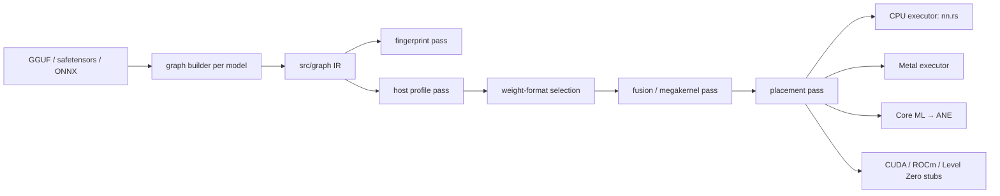

```
   ██████╗ ██╗██████╗ ██████╗ ███████╗    ███████╗███╗   ██╗ ██████╗ ██╗███╗   ██╗███████╗
  ██╔════╝ ██║██╔══██╗██╔══██╗██╔════╝    ██╔════╝████╗  ██║██╔════╝ ██║████╗  ██║██╔════╝
  ██║  ███╗██║██████╔╝██████╔╝███████╗    █████╗  ██╔██╗ ██║██║  ███╗██║██╔██╗ ██║█████╗  
  ██║   ██║██║██╔══██╗██╔══██╗╚════██║    ██╔══╝  ██║╚██╗██║██║   ██║██║██║╚██╗██║██╔══╝  
  ╚██████╔╝██║██████╔╝██████╔╝███████║    ███████╗██║ ╚████║╚██████╔╝██║██║ ╚████║███████╗
   ╚═════╝ ╚═╝╚═════╝ ╚═════╝ ╚══════╝    ╚══════╝╚═╝  ╚═══╝ ╚═════╝ ╚═╝╚═╝  ╚═══╝╚══════╝
  ═════════════════════════════════════════════════════════════════════════════════════════
   JOSIAH WILLARD GIBBS THERMODYNAMIC INFERENCE ENGINE · UNIVERSAL HARDWARE COMPILER
   Apple Silicon · Intel & AMD x86 · ARM Neoverse · NVIDIA CUDA · AMD ROCm · TPUs · ASICs · Extropic
  ═════════════════════════════════════════════════════════════════════════════════════════
```

### What is Gibbs?

**Gibbs** is an architecture-agnostic, zero-overhead computational inference runtime and compiler built in Rust for universal hardware acceleration. Named after **Josiah Willard Gibbs** (1839–1903)—the father of statistical mechanics, vector calculus, and thermodynamic potentials—the engine treats token generation and tensor contraction not as sequential interpreted kernel dispatches, but as an **irreversible thermodynamic flow toward minimum free energy ($dG \le 0$)**.

Designed from first principles to target any computational substrate:
- **Apple Silicon**: Metal Shading Language, unified memory streaming, and Neural Engine (ANE/Core ML).
- **NVIDIA GPUs**: Native CUDA, Tensor Cores, PTX register allocation, and NVFP4/FP8 sub-byte tensor pipelines.
- **AMD GPUs & APUs**: ROCm / HIP compilation, CDNA/RDNA matrix cores.
- **x86 & ARM CPUs**: Intel AVX-512 / AMX, AMD Zen AVX, ARM NEON, SVE2, and SME matrix extensions.
- **Domain-Specific Accelerators**: Google TPUs (XLA/HLO lowering), Custom ASICs, and thermodynamic/probabilistic computing hardware (Extropic).

```
                         Universal Model Graph IR (Pure SSA Form)
                                            │
                                            ▼
                 ┌─────────────────────────────────────────────────────┐
                 │ Luminal-AI Inspired Generic Mathematical Passes     │
                 │  • Subgraph Operator Fusion (Epilogue Clustering)   │
                 │  • Zero-Copy Static Arena Lifetime Coloring         │
                 │  • Multi-Head / DeltaNet / RoPE Composable Lowering │
                 │  • Universal Quantization Unpacking & JESSE LUTs    │
                 └─────────────────────────────────────────────────────┘
                                            │
            ┌───────────────────────────────┼───────────────────────────────┐
            ▼                               ▼                               ▼
   ┌─────────────────┐             ┌─────────────────┐             ┌─────────────────┐
   │  Metal & ANE    │             │  CUDA & ROCm    │             │  CPU SIMD & AMX │
   │ (Apple Silicon) │             │ (NVIDIA & AMD)  │             │ (ARM / x86_64)  │
   └─────────────────┘             └─────────────────┘             └─────────────────┘
            │                               │                               │
            └───────────────────────┬───────┴───────────────────────────────┘
                                    ▼
                   ┌───────────────────────────────────┐
                   │   Emerging & Domain-Specific      │
                   │  TPUs · Custom ASICs · Extropic   │
                   └───────────────────────────────────┘
                                    │
                                    ▼
                 Empirical Roofline Saturation (>92-95% Peak BW)
```

Gibbs serves text generation, translation, summarization, text classification, multimodal vision-language, text-to-image (Stable Diffusion, SDXL, SD3.5, Sana, FLUX), and System 1 embeddings and decisions over an OpenAI-style HTTP API, with native interactive terminal dashboards and full CLI integration.
## Backends

| `--backend` | What runs there |
| :--- | :--- |
| `cpu` (default) | Everything: LLMs (NEON SIMD), native models (Qwen3.5/Qwen3-VL, Qwen3, HunYuan dense, Gemma 4, T5, SmolVLM, Marian/M2M100/NLLB/MBart/FSMT/BART), BitNet, text classifiers, text-to-image, text-to-video, and the System 1 encoder. `--backend metal` on qwen3/HunYuan errors with `qwen3 runs on the CPU only (use --backend cpu)`. |
| `metal` | LLM decode and prefill, with f32 weights (the only format its LLM kernels read, so the engine skips format selection and `--quant` with another format is an error), and the System 1 encoder and BERT-family classifiers through the graph IR's Metal executor. MSL kernels are compiled at load and dispatched on the GPU. LLM kernel results match the CPU within floating-point tolerance, and greedy generated text matched the CPU output in testing. System 1 embeddings match the CPU at cosine ≥ 0.99999 and give the same decisions on a fixed test set. Stable Diffusion, text-to-video, native multimodal models, BitNet, and DeBERTa/decoder classifiers with `metal` are startup errors naming `--backend cpu`. |
| `ane` | System 1 runs on the Apple Neural Engine via Core ML (`--backend ane --system1`), with MLComputePlan preferring the Neural Engine for 100.0% of operations (144/144 ops, 100.0% cost share) across all sequence buckets (`16, 64, 128, 256, 512`), achieving ~1.09 ms embedding requests and warm cache load in ~0.39 s. Other pipelines return startup errors. |
| `cuda`, `rocm`, `level-zero` | Stubs: a startup error, because no such hardware is available to build and verify them. |

Startup prints the detected host (CPU, core counts, memory, GPU, and CPU features such as SME2 and I8MM); nothing in it is assumed.

### Architecture

The design describes every model once in a shared graph IR (`src/graph`) and has each executor run that description; weights are bound by name, so the same graph can also be fingerprinted. Today System 1 runs on CPU, Metal, and the Apple Neural Engine (status below; CPU and Metal run directly from the graph IR, and Core ML runs a native lowering to MIL). [PLAN.md](PLAN.md) has the phases and the measurements behind the design.



| Box | Status |
| :--- | :--- |
| Graph IR, CPU executor | Built. System 1 runs on it. During the cutover its embeddings matched the old hand-written encoder's saved output bit-for-bit (4 texts); the old encoder is gone, so that check cannot be re-run. |
| Graph builders | System 1 runs from its graph; `GraphLm::to_graph` describes the LLM decoder (structure only, not executed). SD and text-to-video still run hand-written code. |
| Fingerprint pass | Built, on the IR. |
| Host profile | Static detection (the startup banner), plus measured Metal micro-benchmarks run once per GPU and OS build and cached in `~/.cache/gibbs/host/`: MPP `matmul2d` checked against the CPU, dispatch cost, and GEMM timings that pick the GEMM kernel per shape. |
| Weight-format selection | Built for LLMs (`src/model/weight_format.rs`), before the backend compiles its kernels. Stage 1 times one decoder layer's GEMVs in every format the backend has kernels for (CPU: f32, f16, bf16, Q8_0, EXL3 3/4/5-bit, NVFP4, hybrid, Weightless Jesse). Stage 2 quantizes only the formats that beat f32 there and teacher-forces a probe text through the whole model; the fastest whose mean KL divergence from f32 stays ≤ 0.01 nats wins. The decision is cached per CPU, backend, weight file, and engine build in `~/.cache/gibbs/host/`. On the M5 Pro CPU, f32 wins for SmolLM2-135M: every other format's GEMV is 2–14× slower, because only the f32 kernel is SIMD and multithreaded. |
| Metal executor | Built for System 1 (`src/graph/metal.rs`): the whole forward pass in one command buffer, activations in one arena planned from value lifetimes, Linear + bias + exact GELU or residual add fused in the GEMM epilogue, three GEMM kernels (MetalPerformancePrimitives `matmul2d`, `simdgroup_matrix`, and one simdgroup per output column for few rows), online-softmax attention, and pipelines cached in an `MTLBinaryArchive` under `~/.cache/gibbs/metal/`. f32 only. Unsupported ops are errors. The LLM still uses its own Metal path (above). |
| Core ML → ANE | Built for System 1 (`src/graph/coreml.rs`): native lowering of BERT layers to MIL with rank-4 layout `[1, C, 1, S]`, 1×1 convolutions, multi-head attention with additive padding mask, exact GELU, LayerNorm with 1D `[C]` gamma/beta (achieving 144/144 ops = 100.0% ANE share on Apple Silicon), external `weights/weight.bin` MILBlob storage with 64-byte aligned metadata and `0xDEADBEEF` sentinel, candidate buckets `[16, 64, 128, 256, 512]` dynamically scanned via `MLComputePlan` (all buckets active with 100% ANE share), and compiled `.mlmodelc` bundles cached under `~/.cache/gibbs/coreml/`. |
| Fusion beyond GEMM epilogues, placement | Planned (PLAN.md P3–P6). |
| CUDA / ROCm / Level Zero | Stubs that return errors. |

## Verified models

| Model | Task | Notes |
| :--- | :--- | :--- |
| `HuggingFaceTB/SmolLM2-135M-Instruct` (safetensors) and `unsloth/SmolLM2-135M-Instruct-GGUF` (Q4_K_M) | Text generation | Greedy output matches llama.cpp token-for-token on Q4_K_M. |
| `THUDM/glm-edge-1.5b-chat` | Text generation | |
| `Qwen/Qwen2.5-0.5B-Instruct` | Text generation | Downloaded, measured, and hot-swapped from the TUI model picker; answers coherently (e.g. "The capital of France is Paris."). Not compared token-for-token against a reference implementation. |
| `Qwen/Qwen2.5-3B-Instruct` | Text generation, sharded safetensors (2 shards, bf16) | Loads through `model.safetensors.index.json`; "The capital of France is Paris." |
| `HuggingFaceTB/SmolLM2-135M-Instruct` `onnx/*.onnx`, `onnx-community/Qwen2.5-Coder-0.5B-Instruct` | Text generation, ONNX | f32 exports (Qwen's with 2 GB external data) match the safetensors originals tensor for tensor (max abs diff 0) and give the same greedy answer; fp16 is within fp16 rounding; int8/uint8/quantized cosine ≥ 0.993, q4/q4f16/bnb4 ≥ 0.994 against the original. `onnx-community/SmolLM2-135M-Instruct-ONNX` was downloaded and hot-swapped from the TUI picker. |
| RedHatAI `Qwen2.5-0.5B-Instruct-quantized.w8a8`, `-FP8-dynamic`, `Qwen2.5-0.5B-quantized.w4a16`, `.w8a16`; `xihc-ucb/Qwen2.5-0.5B-Instruct-vLLM-FP8-Block`; `nm-testing/TinyLlama-1.1B-Chat-v1.0-NVFP4` | Text generation, compressed-tensors | Dequantized tensors against the unquantized originals: min cosine 0.9998 (int8), 0.9997 (FP8 channel and 128×128 block), 0.992 (int4 g64 with g_idx), 0.995 (NVFP4). Instruct models answer "The capital of France is Paris." |
| `CedricHwang/qwen2.5-0.5b-modelopt-fp8-pc-pt`, `Azzam15/qwen2.5-0.5b-nvfp4` | Text generation, NVIDIA modelopt FP8 / NVFP4 | Min cosine 0.9997 / 0.9955 against Qwen2.5-0.5B-Instruct; both answer "The capital of France is Paris." |
| `bartowski/SmolLM2-135M-Instruct-GGUF`, `mradermacher/SmolLM2-135M-Instruct-i1-GGUF`, `Mungert/TriLM_1.1B_Unpacked-GGUF`, `noctrex/SmallThinker-4B-A0.6B-Instruct-MXFP4_MOE-GGUF` | GGUF quant types | Relative RMS error of every tensor against the float GGUF (`tests/gguf_quant_accuracy.rs`): Q8_0 0.006, Q6_K 0.018, Q5_K 0.037, Q4_K 0.076, IQ4_XS 0.080, IQ4_NL 0.058–0.078, MXFP4 0.117 (vs Q8_0), Q3_K 0.152, IQ3_S 0.147, IQ3_XXS 0.194, Q2_K 0.279, IQ2_S 0.264, IQ2_XS 0.313, IQ2_XXS 0.360, IQ1_M 0.477, IQ1_S 0.511, TQ1_0/TQ2_0 0.004 (ternary weights). SmolLM2 Q2_K, Q3_K_M, IQ4_XS, IQ2_M and IQ1_M answer "The capital of France is Paris" (IQ1_M repetitively). |
| `microsoft/bitnet-b1.58-2B-4T` (packed 2-bit), `-bf16` (master weights, ternarized at load), `-gguf` (`ggml-model-i2_s.gguf`, bitnet.cpp I2_S); `1bitLLM/bitnet_b1_58-large` | Text generation, BitNet b1.58 | Per-token int8 activation quant before every projection, `attn_sub_norm`/`ffn_sub_norm`, relu² (2B-4T) or SiLU (1bitLLM) MLP, as in the reference BitLinear. The three 2B-4T variants answer "The capital of France is Paris." at temperature 0. I2_S and packed codes match on all 210 tensors; bf16 masters ternarize to the packed codes except 1.53% that sit within one bf16 step of the rounding threshold. 1bitLLM-large continues "The capital of France is" with " Paris. It is the largest city…". CPU only. |
| `nickypro/tinyllama-110M` (`pytorch_model.bin` only); `nickypro/tinyllama-15M`, `distilbert/distilgpt2`, `hf-internal-testing/tiny-random-bert-sharded`, `mlx-community/whisper-tiny` | PyTorch / Flax / NumPy weights | tinyllama-110M serves `/v1/completions` coherently from its pickle. `.bin`, sharded `.bin`, `flax_model.msgpack`, and `weights.npz` load to tensors bit-identical to the same model's safetensors (or, for whisper-tiny's npz, OpenAI's `tiny.pt`). |
| `Qwen/Qwen3.5-0.8B`, `Qwen/Qwen3.5-2B`, `Qwen/Qwen3-VL-2B-Instruct` | Image-text-to-text (native, CPU, bf16) | Hybrid Gated DeltaNet / gated-attention decoder (Qwen3.5) or dense Qwen3 with deepstack (Qwen3-VL), ViT with interleaved M-RoPE. Answer "Paris" and describe photos of a cat, a dog, the Eiffel Tower and a banana correctly at temperature 0. 0.8B decodes at ~5 tok/s on a heavily loaded host (load average 76–200). |
| `tencent/HY-MT1.5-1.8B-GGUF` (Q4_K_M, llama.cpp `hunyuan-dense`); `unsloth/Qwen3.5-0.8B-GGUF` (BF16, Q8_0) and `unsloth/Qwen3.5-4B-GGUF` (Q3_K_S) (llama.cpp `qwen35`) | Translation and text generation from llama.cpp GGUFs (native, CPU, dequantized to bf16) | llama.cpp's conversion transforms are undone at load (`1 + w` norms, tiled value heads). HY-MT's GGUF tokenizer encodes 13 strings (CJK, kana, digit runs, emoji, whitespace runs) to the same ids as its tokenizer.json, and the model card's en→zh, zh→en and en→de prompts translate correctly at temperature 0. Qwen3.5-0.8B: all 320 tensors against the bf16 safetensors, min cosine 0.9999974 (BF16) / 0.9999762 (Q8_0); greedy chats are token-identical on BF16, and Q8_0 matches on 2 of 3, splitting on the third at a 0.017-logit near tie. 4B (16 key / 32 value heads) answers correctly. Images are refused, because a GGUF carries no vision tower. |
| `tvall43/Qwen3.5-14B-A3B-Claude-4.6-Opus-Reasoning-Distilled-reap-gguf` (MXFP4_MOE, llama.cpp `qwen35moe`: 40 layers, 93 experts, top-8); `Lynxpda/micro-qwen4exp` (Q4_K_M, F16, `qwen4exp`); `malaiwah/qwen4-exp-tiny-random-bf16` (`qwen4_exp` safetensors) | Qwen3.5-MoE and Qwen4-Exp text generation (native, CPU) | Expert banks stay packed in the mmapped file (GGUF block codecs decode one weight row per routed token group; bf16 safetensors experts are borrowed from the mapping); routing is softmax top-k with the sigmoid-gated shared expert. Qwen4-Exp adds hyper-connection streams, QSA block-sparse attention and the hashed n-gram PLE layer; no MTP head, vision tower or rewind. Qwen3.5-MoE GGUF: logits cosine 0.9984 and the same greedy token as llama.cpp on a 22-token chat prompt, answers "Paris". The `qwen4_exp` fixture matches transformers' captured final hidden states (cosine ≥ 0.99965 on four 64-token windows). |
| `HuggingFaceTB/SmolVLM-256M-Instruct`, `SmolVLM-500M-Instruct`, `SmolVLM2-256M-Video-Instruct` (images) | Image-text-to-text (Idefics3: SigLIP + pixel-shuffle connector + GraphLm text model, CPU) | Preprocessing follows `Idefics3ImageProcessor` (longest edge 2048, 512-px tiles plus a global view, 64 tokens per tile). Describes the same four photos correctly from PNG, baseline JPEG and progressive JPEG; a drawn red disc gives "Red."; text prompts answer "Paris". An image is up to ~1100 prompt tokens, prefilled one token at a time. |
| `google/gemma-4-E2B-it`, `google/gemma-4-E4B-it` | Any-to-any: text + image + speech (WAV, ≤30 s) → text (native, CPU, bf16 memory-mapped) | Per-layer embeddings, sliding/full attention with KV sharing, softcapped logits, vision tower and conformer audio encoder as in transformers. Correct factual answers, photo descriptions, and word-for-word transcripts of `say`-generated speech at temperature 0; a >1100-token prompt prefilled in chunks matches one-shot prefill. RSS ~5 GB (E2B) / ~10 GB (E4B). |
| `google/gemma-4-12B-it` (`gemma4_unified`) | Text + image + WAV audio → text (native, CPU, bf16 memory-mapped) | Encoder-free image and audio embedders; image tokens attend bidirectionally on sliding layers, and chunked prefill never splits an image. At temperature 0: "Paris", "Cat" for a cat photo, correct descriptions of the Eiffel Tower, a banana and a dog, and word-for-word transcripts of 16 kHz and 22 kHz WAVs (tests and HTTP). Peak memory 25.3 GB; ~5 tok/s decode, 14–17 tok/s prefill. `/v1/messages/count_tokens` counts images and audio without running the encoders. |
| `ggml-org/gemma-4-E2B-it-GGUF` (`gemma-4-E2B-it-Q4_0.gguf` + `mmproj-gemma-4-E2B-it-Q8_0.gguf`, llama.cpp `gemma4`) | Any-to-any from a llama.cpp GGUF: text + image + speech → text (native, CPU, dequantized to bf16) | The decoder's tensors are renamed to their transformers names and the `gemma4.*` metadata becomes the config (sliding pattern, per-type head dims and KV heads, shared-KV layers, per-layer embeddings, softcap, the `rope_freqs` 1/1e30 mask → partial rotary); the per-layer embedding table stays quantized in the mapped file and its rows are decoded per token. The `mmproj` (`gemma4v` / `gemma4a`) is fetched with the weights and renamed to the vision and audio towers (conv kernel re-laid-out, softplus'ed `per_dim_scale` inverted). The GGUF tokenizer (`gemma4` BPE) encodes 12 strings to llama.cpp's ids. Next-token logits after "The capital of France is" vs `llama-debug --save-logits` (build 11304, same file): cosine 0.99979 over the 262144 logits, top-5 within 0.05. "Paris", "Cat" for a cat photo, correct descriptions of cat, dog, Eiffel Tower and banana, and a word-for-word transcript of `say` speech, over HTTP, the test and the picker. 8.3 GB peak RSS. Not verified: 12B (`gemma4_unified`) GGUFs (smallest quant exceeds the cache budget; their encoder-free projectors are refused at image time); the 26B-A4B MoE is refused. |
| `Qwen/Qwen3-0.6B`, `Qwen/Qwen3-1.7B`, `Qwen/Qwen3-0.6B-GGUF` (Q8_0), `unsloth/Qwen3-0.6B-GGUF` (BF16), `tencent/Hunyuan-0.5B-Instruct`, `tencent/Hunyuan-MT-7B` | Text generation, translation (native, CPU, bf16) | Dense Qwen3 and HunYuan dense v1 on the native bf16 decoder. Qwen3-0.6B logits within 9.3e-5 of a scalar f32 reference written from `modeling_qwen3.py`; the BF16 GGUF decodes token-for-token like the safetensors repo. "Paris", "Jupiter", "391" at temperature 0 with thinking on and off (1.7B). Hunyuan-MT-7B translates EN→ZH, EN→FR and ZH→EN correctly at 14.3 GB peak RSS. |
| `google-t5/t5-small`, `google/t5-v1_1-small`, `google/flan-t5-base`, `google/umt5-small`, `csebuetnlp/mT5_multilingual_XLSum`, `google/madlad400-3b-mt` (candle q4k GGUF) | T5 / mT5 / UMT5 (native, CPU) | Scores match transformers' integration tests (t5-small −19.0846 vs −19.0845, t5-v1_1-small −59.0293 vs −59.0293); umt5-small fills spans exactly as transformers. t5-small: "Das Haus ist wunderbar."; MADLAD (`<2de>` prefix) translates to German, French and Japanese at ~13.8 GB peak. |
| `facebook/wmt19-en-de` (FSMT), `facebook/m2m100_418M`, `Helsinki-NLP/opus-mt-tc-big-en-pt`, `facebook/mbart-large-50-many-to-many-mmt` (ar→en), `sshleifer/distilbart-cnn-12-6`; `Helsinki-NLP/opus-mt-en-de`, `facebook/nllb-200-distilled-600M` | Translation, summarization (encoder-decoder, CPU) | Outputs equal the model-card / transformers-docs examples exactly. Known mismatches: mbart-50 hi→fr ("en Syria" vs the card's "dans la") and bart-large-cnn's summary. NLLB streams token by token. |
| `puettmann/LlaMaestra-3.2-1B-Translation`, `puettmann/SmolMaestra-1.7b-Translation`, `BSC-LT/salamandraTA-2b-instruct` | Translation (decoder-only) | Picker shows them loadable; correct translations over HTTP at temperature 0. |
| `distilbert/distilbert-base-uncased-finetuned-sst-2-english`, `cardiffnlp/twitter-roberta-base-sentiment-latest`, `SamLowe/roberta-base-go_emotions`, `papluca/xlm-roberta-base-language-detection`, `protectai/deberta-v3-base-prompt-injection-v2`, `cross-encoder/ms-marco-MiniLM-L-6-v2`, `BAAI/bge-reranker-base`, `trl-lib/Qwen2-0.5B-Reward`, `Skywork/Skywork-Reward-V2-Llama-3.2-1B` | Text classification, reranking, reward scoring | BERT/RoBERTa/XLM-R/DistilBERT run on the System 1 BERT graph (CPU or Metal); DeBERTa-v2/v3 and Llama/Qwen2 `ForSequenceClassification` on CPU. Match model-card values: twitter-roberta 0.7236/0.2287/0.0477, ms-marco 8.607/−4.320; go_emotions scores as multi-label; rerankers and reward models order relevant/correct answers first. |
| `cirimus/modernbert-base-go-emotions`, `cmarkea/distilcamembert-base-sentiment`, `daekeun-ml/koelectra-small-v3-nsmc`, `KoalaAI/Text-Moderation`, `tals/albert-xlarge-vitaminc-mnli`, `nie3e/sentiment-polish-gpt2-small`, `hfmlsoc/ncii-guard-v02`, `facebook/fasttext-language-identification`, `olaverse/lid-lite-608`, `gpustack/bge-reranker-v2-m3-GGUF`, `alirezaaminzadeh/agentshield-policy-decision-model`, `vllm-sr/mmbert-jailbreak-detector-lora`, `velddev/nest-sparrow-checkpoint`, `Skywork/Skywork-Reward-V2-Qwen3-0.6B`, `anespo28/openjev-fincalc-4b` | Text classification: ModernBERT, CamemBERT, ELECTRA, DeBERTa v1, ALBERT, GPT-2, OPT, Gemma 3 text, Qwen3, Qwen3.5, fastText, GGUF (`bert`), SetFit, PEFT LoRA | Card values reproduced: go-emotions 0.9756/0.6978/0.0120 (card 0.976/0.698/0.012); distilcamembert and koelectra to 6 digits; polish-gpt2 POSITIVE 0.99998903; ncii-guard all 6 values within 2e-3; fastText eng_Latn 0.61224753 (card's k=5 list exactly); bge-reranker Q8_0 5.2405/−8.1775/−5.6625 (card 5.2617/−8.1875/−5.6523); SetFit gets all three card labels; nest-sparrow (LoRA merged into Qwen3-0.6B) 0.8959/0.9786 (card 0.896/0.981); openjev-fincalc 19/19. facebook/opt-350m hidden states within 5e-5 of transformers. |
| `gpustack/stable-diffusion-v2-1-turbo-GGUF` | Text-to-image and image-to-image, 512×512 | By default the smallest quant (Q4_0) is used, and it produces striped images. Set `GIBBS_QUANT=FP16` for clean 1-step images. |
| `stabilityai/sd-turbo`, `stable-diffusion-v1-5/stable-diffusion-v1-5`, `stabilityai/sdxl-turbo`, `stabilityai/stable-diffusion-xl-base-1.0`, `SimianLuo/LCM_Dreamshaper_v7`; LoRAs `SedatAl/pixel-art-LoRa` (SD1.5), `nerijs/pixel-art-xl` (SDXL); single-file `HyperX-Sentience/Juggernaut-Reborn` | Text-to-image, image-to-image (diffusers, CPU) | On-prompt images, checked by eye. s/step (denoising) and peak RSS: sd-turbo 1 step 512 ~16 s/image, 5.2 GB; SD1.5 20 steps CFG 7.5 5.4–6.2, 4.9 GB; sdxl-turbo 1 step 4.2, 12.3 GB; SDXL base 768² CFG 5 13.0, 12.4 GB; LCM 4 steps 768 10.2, 4.1 GB; SD1.5 LoRA ~8.3, 4.8 GB; SDXL LoRA 11.5, 13.0 GB; Juggernaut 6.9, 4.9 GB. LoRAs visibly change style against the same seed without them. |
| `Efficient-Large-Model/Sana_600M_512px_diffusers`, `adamo1139/stable-diffusion-3.5-medium-ungated` | Text-to-image (DiT, CPU) | Verified before the final rebase: Sana 512px 20 steps 3.94 s/step, 7.46 GB (CLI, HTTP and TUI); SD3.5-medium 512px 28 steps 10.95 s/step, 15.67 GB. Host was shared, so s/step is an upper bound. |
| `city96/FLUX.1-schnell-gguf` (`flux1-schnell-Q4_0.gguf`) with FLUX.1-schnell's CLIP-L, T5-XXL and VAE | Text-to-image (FLUX, CPU) | On-prompt fox at 512², 4 steps: 52–68 s/step on a shared host, peak RSS 17.06 GB. Pre-rebase code, through a test driver rather than the hub path. |
| `turboderp/Llama-3.2-1B-Instruct-exl3@4.0bpw` / `@2.5bpw`, `blockblockblock/Qwen2.5-0.5B-Instruct-exl3-4.0bpw` / `-3.0bpw`, `turboderp/Qwen3-0.6B-exl3@4.0bpw`, `Honkware/Qwen3.5-0.8B-exl3-4.0bpw` | Text generation, EXL3 | Tiles bit-exact against the reference kernel (3INST, MCG, MUL1, half-integer K). Cosine vs the unquantized original: 4-bit 0.9962–0.9974, head 0.9997+, 3-bit 0.9856–0.9897, 2-bit 0.9443–0.9601. All answer "Paris"; the Qwen3.5 model also names a cat in a photo. |
| `amd-quark/Qwen3-1.7B-MXFP4`, `matmelis/Llama_3.2_1B_w_mxfp4_a_mxfp4_gptq`, `matmelis/Llama_3.2_1B_w_uint4_gptq`, `aigdat/Llama-3.2-1B-Instruct-awq-uint4-float16`, `amd/Qwen2.5-1.5B-Instruct-ptpc-Quark-ts`, `amd/Llama-3.2-1B-Instruct-FP8-KV` | Text generation, AMD Quark / `fp8` | All answer "Paris" at temperature 0. Worst cosine vs original: fp8 0.9996, int8 0.992, uint4/int4 GPTQ 0.982–0.987, MXFP4 0.982, MXFP6 0.9986–0.9995, int3 0.944, int2 0.776 (GPTQ optimizes output error, not weight error). |
| `xv0y5ncu/SmolLM2-135M-Instruct-GLQ-4bpw`, `xv0y5ncu/SmolLM2-360M-Instruct-GLQ-trellis-3inst-4bpw` | Text generation, GLQ | Worst cosine 0.99386 / 0.99545 vs the bf16 originals, through both GraphLm and the native path; both answer "Paris". |
| `Qwen/Qwen3.5-0.8B`, `Qwen/Qwen3.5-2B` with their MTP head; attached drafters `rasyosef/Qwen3.5-2B-DSpark`, `rasyosef/Qwen3.5-2B-DFlash2`, `taobao-mnn/Qwen3.5-2B-Dflash`, `Qwen/Qwen3.5-0.8B` (plain draft model), `rasyosef/Llama-3.2-1B-Instruct-DSpark` | Speculative decoding | Greedy output token-identical to plain decoding for every pair. See [Speculative decoding](#speculative-decoding) for speeds. |
| `sentence-transformers/all-MiniLM-L6-v2` | System 1 (BERT encoder) | Produces 384-d embeddings and zero-shot cosine decisions. |
| `ali-vilab/text-to-video-ms-1.7b` | Text-to-video, 256×256, 16 frames, CLI only | 10 example clips judged by an independent Gemini verifier: 6 fully on-prompt, 4 coherent but missing a prompt detail, 0 broken. CC-BY-NC-4.0. |
| `city96/LTX-Video-gguf` (Q4_0 + `LTX-Video-VAE-BF16.safetensors`), `city96/t5-v1_1-xxl-encoder-gguf` (Q4_K_M) | Text-to-video and image-to-video, LTX-Video v0.9.0 2B, 512×320, 9–25 frames, CLI and TUI | A 25-frame prompt clip shows the red balloon, meadow and sky asked for; image-to-video keeps the given first frame (PSNR 36.6 dB against the input after mp4 encoding). VAE encode→decode PSNR 31.3 dB on a procedural picture. No reference implementation run: checked by those outputs and by tests. |

### Weight files

Every GraphLm checkpoint is expanded to f32 at load; the engine then measures and picks the runtime weight format (see [Architecture](#architecture)). Native models (Qwen3.5/Qwen3-VL, Qwen3, HunYuan dense, Gemma 4, T5) memory-map their bf16 safetensors (single or sharded; Qwen3.5-0.8B serves with a 284 MB footprint) and run their own CPU kernels; they are chosen from `config.json` `model_type` before the GraphLm path. Native qwen3 also loads `*.gguf` with `general.architecture = qwen3`, and Gemma 4 `general.architecture = gemma4` with its `mmproj` (both dequantized to bf16); T5 loads safetensors, `.bin`, Flax and candle GGUF, with `tokenizer.json` or `spiece.model`.

- **Safetensors**: one file, or sharded through `model.safetensors.index.json` (all shards are read into one buffer; Qwen3.5's `model.safetensors-00001-of-00001.safetensors` naming included). F32/F16/BF16/F8_E4M3/F8_E5M2 tensors decode natively.
- **Pre-quantized safetensors**: compressed-tensors `int-quantized` and `naive-quantized` (int8), `float-quantized` (FP8 per tensor, per channel, or 128×128 blocks), `pack-quantized` (int4/int8, symmetric or asymmetric, group or channel, activation-order `g_idx`), and `nvfp4-pack-quantized`; NVIDIA modelopt FP8 and NVFP4 (`quantization_config` or `hf_quant_config.json`); BitNet `quant_method: "bitnet"` with `linear_class: "autobitlinear"` (2-bit packed, unpacked as transformers' `unpack_weights`). GPTQ, AWQ, bitsandbytes, sparse/marlin, rotated (`transform_config`), and BitNet `bitlinear` checkpoints are refused with the reason before any weight is read; the hub picker applies the same rule.
- **AMD Quark** (`quant_method: "quark"`): fp8_e4m3/e5m2, int8, int4/uint4 per-group (`reorder`/`order` packing, zero points), int3/int2 per-group, OCP MXFP4 and MXFP6 (e8m0 scales, group 32); honours `layer_quant_config`, `layer_type_quant_config` and `exclude`. Also vLLM `quant_method: "fp8"` per-tensor. Multi-stage (NVFP4 `[fp4, fp8]`, W4A8) and online-rotation exports are refused at load; the picker can't see quark sub-schemes, so those refusals come at load.
- **MLX-packed** (mlx-community / mlx-vlm), decoded to owned bf16 for native models; Qwen3.5 checked against the original (nvfp4 min cosine 0.99133 over all 187 packed tensors).
- **EXL3** (`quant_method: "exl3"`): 3INST, MCG and MUL1 codebooks, 1–8 bit and 1.5/2.5/3.5-bit trellises; decoded once at load (f32 for GraphLm, bf16 for native), so it saves no memory. Repos that keep each bitrate in a branch load as `org/repo@<branch>`; the picker lists the branches as rows. Trellis-quantized embedding tables are refused.
- **GLQ** (`quant_method: glq`): e8_shell, e8p (2–4 bpw) and trellis 3inst (kernel layout); decoded at load. Trellis `hyb`, `e8_relaxed`, e8p 5–8 bpw and trellis-coded embedding tables are refused.
- **PEFT LoRA**: classifier adapters merged when weights are read; generator adapters merged once into a cached full copy of the base. DoRA, per-module rank/alpha, and classifier LoRAs on decoder bases are refused.
- **fastText** `.bin`/`.ftz` and **SetFit** (LogisticRegression head) classifiers.
- **compressed-tensors `mixed-precision`**: each `config_groups` entry keeps its own scheme (int4/int8 pack-quantized, FP8, NVFP4, int-quantized, ...) and `ignore` lists are honoured; groups in mxfp4/mxfp8 are refused by name. Checked on `nm-testing/nvfp4_fp8_mixed-e2e` and `nm-testing/multiple_modifiers_gptq_awq-e2e` against a TinyLlama twin (cosine 0.9916–0.99996, correct greedy output).
- **NInfer** (`*.ninfer`, library `ninfer`): dense Qwen3.5 / 3.6 / 3.8 text models and, in v3 artifacts, the vision tower, read through the artifact's own catalog. The v2 0.8B artifact matches `Qwen/Qwen3.5-0.8B` tensor by tensor (cosine 0.9916–0.9987) and answers correctly; four v3 codecs (q4/q5, fp8-row, nvfp4, gguf_iq3_s) match `Qwen/Qwen3.8-27B` layer-3 K/V at cosine 0.969–0.9997. MoE, Qwen4Exp, ASR and v1 artifacts and unknown codecs are refused with a specific reason; no 27B artifact was loaded end to end (bf16 expansion needs more than 48 GB). `Xiaomi-OCR-0-Ninfer` loads with its vision tower, but an image request fails in the chat template (HTTP 400, cause not found); text requests work.
- **Split GGUF** (`name-00001-of-00003.gguf`): a shard set is one weight set. All shards of the chosen quantization are downloaded (never mixing quantizations; a missing shard is named), llama.cpp's `split.no` / `split.count` / `split.tensors.count` are validated, and every GGUF reader opens the set through one opener. A split set is read into one buffer (a single file stays memory-mapped). Checked on `owalsh/SmolLM2-135M-Instruct-GGUF-Split`: output identical to the merged file. A split set of an architecture no loader runs (e.g. `glm_moe_dsa`) is refused with the architecture named.
- **llama.cpp `dflash` GGUF sidecars** (DSpark, DFlash): attach with `--draft` or `Enter` on the row; `satgeze/Qwen3.5-0.8B-DSpark` matches its safetensors twin (identical draft tokens, worst logit cosine 1.0) and temperature-0 server output is identical with and without it. The DFlash2 (conv/selector) mapping is written from llama.cpp's source and has not run on real weights; fork architectures (`dflash-draft`, ...) and pruned-vocabulary sidecars (`d2t` is an I64 tensor) are refused.
- **GGUF**: F32, F16, BF16, Q4_0, Q4_1, Q5_0, Q5_1, Q8_0, Q2_K–Q6_K, IQ1_S, IQ1_M, IQ2_XXS, IQ2_XS, IQ2_S, IQ3_XXS, IQ3_S, IQ4_NL, IQ4_XS, TQ1_0, TQ2_0, MXFP4, and bitnet.cpp's I2_S (type 36 in `bitnet-b1.58` files), tensor by tensor (so mixed files like Q3_K_M, IQ3_M, and imatrix quants work). Q8_K, repacked Q4_0_x_y/IQ4_NL_x_y, and NVFP4/Q1_0/Q2_0 GGUFs are refused with the type name.
- **ONNX**: decoder exports from optimum, transformers.js, and onnxruntime-genai (`onnx/model.onnx`, `model_fp16`, `model_q4`, `model_q4f16`, `model_int8`, `model_uint8`, `model_quantized`, `model_bnb4`), including external data files. The graph is not executed: weights are pulled out of `MatMul`/`Gemm`, `MatMulNBits`, `MatMulBnb4`, `MatMulInteger`, and `DequantizeLinear` into the Hugging Face tensor names. Ops whose weights it does not decode (e.g. `QLinearMatMul`, `GatherBlockQuantized`, `QAttention`) are errors naming the op and node.
- **PyTorch pickle**: `pytorch_model.bin`, `*.pt`, `*.pth`, `*.ckpt`, and sharded `pytorch_model.bin.index.json`, in zip, legacy, and tar containers, read by a restricted unpickler that never runs code; `state_dict`/`model`/`model_state_dict`/`module.` wrappers are unwrapped. TorchScript archives (including rust-bert `.ot`) are refused.
- **Flax** `flax_model.msgpack` (and `.index.json` shards), renamed to the PyTorch names with dense kernels transposed; **NumPy** `weights.npz` / `*.npy` (uncompressed `np.savez`/`mx.savez`). TF `tf_model.h5`, `.tflite`, and Core ML packages are not supported (named in the selection error).

Which files are downloaded: the hub lists the repo (Hugging Face tree API), fetches `config.json`, `tokenizer.json`, `tokenizer_config.json`, `generation_config.json`, `hf_quant_config.json`, `tokenizer.model`, `special_tokens_map.json`, `chat_template.jinja`, `chat_template.json`, `preprocessor_config.json`, and `processor_config.json` when present, and one weight set: the smallest at or above 4.5 bits per weight among GGUF files and single or sharded safetensors, else ONNX (smallest download), else a GGUF below 4.5 bpw, else PyTorch/Flax/NumPy weights (smallest download; optimizer, scheduler, trainer-state, and LoRA-adapter files are never weights). `GIBBS_QUANT` picks a specific file and never falls back; a GGUF size tag must match the file's own tag (`Q3_K_M` never yields `-Q3_K_L`, `q4_k` spans `Q4_K_S`/`Q4_K_M`). `--model org/repo/<file>.gguf|.safetensors|.bin|.pt|.pth|.ckpt|.msgpack|.npz|.npy` forces one file (any `.bin`, e.g. a non-`pytorch_model` name, only this way). A cached repo is resolved by the same rule from the files on disk. `mmproj` GGUFs (`mmproj-*.gguf`, `*-mmproj.gguf`) are never the weights; for a `gemma4` GGUF repo the smallest one beside the weights is fetched with them, and a repo of projectors alone is refused with `vision projector only (mmproj); load the language-model repo, it fetches this projector`.

## Measured performance

Measured on an Apple M5 Pro with 15 CPU threads.

| Workload | CPU | Metal | ANE |
| :--- | :--- | :--- | :--- |
| SmolLM2-135M greedy decode (HTTP, 64 tokens) | ~90 tok/s | ~197 tok/s (205.7 tok/s CLI decode) | n/a (planned P5) |
| GLM-edge-1.5B decode | ~19 tok/s (18.1–19.4, inter-token p50 51–55 ms, this release) | ~31 tok/s | n/a (planned P5) |
| SD 2.1 Turbo 512×512, FP16, 1 step | ~4.2 s/image | n/a (CPU only) | n/a (planned P3) |
| SD 2.1 Turbo 512×512, Q4_0, 4 steps | ~8.5 s/image (shows striping artifacts) | n/a (CPU only) | n/a (planned P3) |
| System 1 `/v1/embeddings` request | ~5.2 ms (p50, curl wall time over loopback) | ~2.0 ms | ~1.1 ms (50 reqs, loopback p50=1.09 ms, p90=1.14 ms) |
| System 1 encoder pass, 12 / 128 tokens (in-process) | ~4.6 / ~17.4 ms | ~0.86 / ~2.6 ms | ~0.32 / ~0.91 ms (p50) |
| System 1 `/v1/decisions`, 2 questions (6 encoder passes) | ~24 ms (p50) | ~9.0 ms | ~2.8 ms (p50=2.76 ms, p90=2.88 ms) |
| System 1 encoder load | n/a | ~0.9 s cold / ~0.04 s warm | ~7.4 s cold (all 5 buckets compiled) / ~0.39 s warm (cache hit) |
| ModelScope text-to-video 256×256, 16 frames, 25 steps | ~8.5 min per clip (~20 s/step) | n/a (CPU only) | n/a (planned P4) |

*With 1D gamma/beta shapes for LayerNorm, MLComputePlan prefers the Neural Engine for 100% of operations (144/144) across all sequence buckets (`16, 64, 128, 256, 512`), eliminating CPU-ANE round-trips. Observed latency (~0.32 ms encoder pass at 12 tokens, ~0.91 ms at 128 tokens, and ~1.09 ms loopback HTTP embedding latency) is consistent with execution on the Apple Neural Engine.*
## Quickstart

### Build
```bash
cargo build --release      # or: make release
# Produces ./target/release/gibbs (also ./target/release/foundry-engine)

make tui                   # build, then open the dashboard
make tui ARGS="--model THUDM/glm-edge-1.5b-chat --port 8081"
```

### Text generation server
```bash
# Defaults: --model HuggingFaceTB/SmolLM2-135M-Instruct, --port 8080, --backend cpu, weight format chosen by the engine
./target/release/gibbs --model HuggingFaceTB/SmolLM2-135M-Instruct --port 8080 --tui

# GGUF checkpoint
./target/release/gibbs --model unsloth/SmolLM2-135M-Instruct-GGUF --port 8080

# Apple GPU decode (f32 weights only)
./target/release/gibbs --model unsloth/SmolLM2-135M-Instruct-GGUF --backend metal --port 8080
```

### Flags and environment

| Flag / env | Meaning |
| :--- | :--- |
| `--model <id or path>` | A Hugging Face repo, `org/repo@<branch>`, or a local path. The kind of model comes from its files: a diffusers `model_index.json` (text-to-image or text-to-video), an SD/FLUX GGUF or single-file checkpoint or LoRA, a classifier `architectures` entry, a native `model_type` (Qwen3.5/Qwen3-VL, Qwen3, HunYuan dense, Gemma 4, T5/mT5/UMT5, Marian/M2M100/NLLB/MBart/FSMT/BART, Idefics3/SmolVLM), else a GraphLm causal LM. |
| `--backend cpu\|metal\|ane\|cuda\|rocm\|level-zero` | The compute backend (see [Backends](#backends)). `ane`, `cuda`, `rocm`, and `level-zero` fail at startup. With `metal`, the Metal pipeline cache and host profile go to `~/.cache/gibbs/`. |
| `--quant <format>` | Overrides the engine's weight-format choice: `uncompressed` (f32), `f16`, `bf16`, `q8_0`, `nvfp4`, `exl3-3`/`exl3-4`/`exl3-5`, `hybrid`, `turbo`, or `jesse`. Without it the engine measures and picks (see [Architecture](#architecture)). A format the backend has no kernels for is an error. |
| `GIBBS_QUANT=<quant>` | Chooses which weight file to fetch: a GGUF quant (`Q4_K_M`, `IQ4_XS`, `FP16`, …) or an ONNX variant (`fp32`, `fp16`, `q4`, `q4f16`, `int8`, `uint8`, `quantized`, `bnb4`). Only a matching file is used. |
| `--system1` | Loads the System 1 encoder. |
| `--system1-model <repo>` | The BERT encoder used by `--system1`. It needs `config.json`, `tokenizer.json`, and `model.safetensors`. The default is `sentence-transformers/all-MiniLM-L6-v2`. |
| `--seed <n>` | The image/video seed. Without it, a clock-based seed is used and printed so you can reproduce the run. |
| `--prompt`, `--image`, `--output`, `--steps`, `--strength` (default 0.7), `--negative-prompt`, `--width`, `--height`, `--guidance` | Run one image generation from the CLI; steps, size and guidance default from the model. With an LLM, `--prompt` generates once and exits; with a classifier, `--prompt "text"` (or `"a \|\| b"`) prints the scores and exits. |
| `--draft <repo>` | Attaches a speculative drafter (DFlash, DFlash2, DSpark, or a small LM with the same tokenizer). See [Speculative decoding](#speculative-decoding). |
| `GIBBS_SPEC=off` | Disables speculative decoding (built-in MTP heads and `--draft`). |
| `--frames` (default 16), `--guidance` (default 9.0), `--steps` (default 25), `--output <file.mp4>` | Text-to-video options (see [Text-to-video](#text-to-video-modelscope-from-the-cli)); LTX-Video has its own defaults, `--image` (first frame) and `--text-encoder`. |
| `--tui` | Opens the terminal dashboard. |
| `--hf-token`, `--port`, `--storage` | Hugging Face auth, listen port, and storage backend. |

**Sampling defaults.** A request that omits `temperature`/`top_p` takes `generation_config.json`'s values when it sets them (`do_sample: false` means greedy), as vLLM does; configs silent on both keep the engine defaults. Encoder-decoders (T5 family, Marian/M2M100/NLLB/MBart/FSMT/BART) default to greedy. Seq2seq models whose generation_config sets `num_beams > 1` run beam search, which ignores sampling parameters (`max_tokens` and client disconnect still apply); greedy seq2seq configs decode and stream token by token. Generation stops on generation_config's `eos_token_id`s and the template's turn-end special tokens. OpenAI chat accepts `chat_template_kwargs` (e.g. `{"enable_thinking": false}`); Ollama `/api/chat` accepts `think: false`.

There are no runtime tuning knobs. The engine sets serving parameters itself: the weight format is measured at load; a sequence ends at the model's context length; and the prompt tokens prefilled per scheduler step come from measured costs. While other sequences decode, a step's prefill is sized to cost about one decode round (at least one token); otherwise it is sized to about 100 ms. Prompts with the fewest remaining tokens go first, and the oldest prompt still prefilling keeps up to half of each step's budget, so a stream of short prompts cannot hold a long one back. On CPU, where one prompt token can cost more than a decode round, a stream's median gap between tokens went from 18.9 ms to 40.9 ms (p90 73 ms, max 300 ms) while a 481-token prompt was ingested. The TUI shows the current budget. The default `temperature` is 1.0.

### TUI (`--tui`, or `make tui`)

One screen, redrawn on input and streamed output and every 250 ms otherwise; prompts and model loads run in the background, so the UI never blocks.

| Panel | Shows |
| :--- | :--- |
| Status line | Served model, backend, weight format, HTTP port, running prompts, and a `/connect` hint. While a model loads: its stage, and during downloads the file, percent, MB done/total, and MB/s. |
| Throughput | Tokens/s (3 s window), tokens per second over the last 2 minutes, totals, TTFT and inter-token latency p50/p90 over the last 512 samples, KV admission blocks in use. |
| Requests | Every admitted sequence (prefill progress, output count, age, and the API and client user-agent for HTTP requests, e.g. `anthropic · claude-cli/…`), the waiting queue, the prefill budget per step, and the last step's duration. |
| Console | Prompts and model loads with streamed output, timing, and finish reason (`cancelled` when stopped). A finished load shows the downloaded size, or `cached`. |
| Weights | The weight format in use and how it was chosen; per candidate the measured GEMV time per layer, its ratio to f32, and, when probed, decode ms/token and KL divergence. |
| Host, Log | Detected hardware and the HTTP address; the engine log. |

| Key | Action |
| :--- | :--- |
| `i`, `p`, `Enter` | Focus the prompt (`/` also starts a command). In the prompt, `Enter` (or `Ctrl-J`/`Ctrl-M`) runs, `Ctrl-U` clears, and `Esc` cancels the newest running chat, or goes back when none runs. |
| `Ctrl-X` | Cancel the newest running chat. Its sequence stops on the next scheduler step. |
| `m` | Open the model picker. |
| `↑↓` / `j k`, `PgUp PgDn`, `Home End` | Scroll the console. |
| `q` | Quit from the dashboard; `Ctrl-C` quits anywhere. |

**Model picker.** Type to search the cached models, the verified models, and huggingface.co (through `curl`, 250 ms after the last key; `HF_TOKEN` is sent when set). The match is fuzzy: every space-separated term must appear in the repo id in order, e.g. `smol inst`, and letters can be left out (`smolm2 inst` finds SmolLM2-…-Instruct) because the picker also searches with shortened terms when a query has few hits; swapped or wrong letters still miss. Nothing is filtered by tag or pipeline: not-for-all-audiences and gated repos are listed (gated ones need `HF_TOKEN`). `Tab` cycles the sort between favorites (♥ likes, the default), most downloaded, and most recently updated; the header of the sorted column is bold, underlined and cyan, and that column is the last one dropped when the window is narrow. Columns: parameters, download size (exact for the highlighted row, from the repo listing; `~` estimates elsewhere; size on disk for cached repos), ♥ likes, ↓ downloads, last update, and status (cached, gated, or in red why the loader cannot run it: no weights it reads, an unsupported pre-quantization, a pipeline whose architecture no loader implements (text-classification, image-text-to-text, and any-to-any repos load when their `architectures`/`model_type` is supported), or more memory or disk than the host has). Memory is checked against what the loader holds: native models keep bf16 weights (also from a quantized checkpoint, which they expand), other models hold f32 when that fits in half of memory and otherwise are encoded while loading into the most exact 3–16-bit CPU format that fits (`--backend cpu`). A row that does not fit is replaced by its most downloaded loadable quantized derivative (`base_model:quantized:<id>`, at least 90 % of the base's weights, ungated, fits the free disk): the status reads `too large; loads quantized <repo>` and `Enter` loads that repo; otherwise the refusal says the hub lists none. `Enter` on a row, or on a typed `org/repo` that matches nothing, downloads the model into the cache, measures its weight format, and hot-swaps it into the scheduler. If loading fails (for example, an architecture the loader does not implement), the old model keeps serving, the error appears in the console, and a record of what failed (error, load stage, the snapshot's files, `config.json` summary, safetensors tensor names) is appended to `<cache>/load-failures.log`; the CLI and server write the same log when their startup load fails. `Ctrl-D` (or `Delete`) twice within 3 s on a cached row deletes `<cache>/models--<org>--<repo>`; the active and the loading model are refused. The footer shows free disk space.

The picker gives every refused repo a specific reason (remote code, custom PEFT head, non-transformers library, no config.json, unsupported pipeline, …). GGUF repos tagged for a non-generation task load when their llama.cpp architecture is llama, qwen2, qwen3, hunyuan-dense, qwen35 or gemma4; otherwise the row says `llama.cpp GGUF architecture 'X' (not supported; …)`. Native model types whose repo ships only GGUF weights and has no GGUF loader (qwen3_vl, idefics3, …) say `'X' loads from safetensors only; this repo's weights are GGUF`. Drafter repos show as attachable; `Enter` attaches one to the active model. Over the top 300 Hub repos per task, the picker allows: text-classification 245, translation 209, summarization 204, zero-shot-classification 191, text-to-image 115, image-text-to-text 74 (no refused row carries the generic "not text generation" text any more). Its memory check for image pipelines counts only the denoiser, not the text encoders, so it overstates fit (SD3.5-medium peaks at 15.7 GB).

Prompt console commands:

| Input | Runs | Output |
| :--- | :--- | :--- |
| bare text | Routed by the active model (LLM, classifier, image, embedding, or decision) | Depends on the model |
| `/chat <text>` | LLM, streamed until EOS or the end of the model's context. `@<path>` words naming an existing `.png`/`.jpg`/`.jpeg` or `.wav` file attach it as an image or audio input, in prompt order (e.g. `@~/cat.jpg What is this?`); a model that can't take it says why | Text, with token count, decode tok/s, and finish reason; attachments are listed |
| `/image <prompt>` | The loaded text-to-image model (defaults from the model, e.g. 1 step for turbo); bare prompts also generate while it is active | `tui_image_NNN.png` plus an ASCII preview |
| `/decide <query> [\| opt, opt]` | System 1 (bool, or choice when options are given) | JSON |
| `/embed <text>` | System 1 encoder | JSON (dims, L2 norm, vector head) |
| `/classify <text>` (`/cls`; `<query> \|\| <passage>` for pair models) | The loaded classifier (sequence classifiers, rerankers, reward models, fastText, SetFit); bare text classifies while one is active, and loading an LLM makes the LLM active again | Labels with score bars |
| `/connect` | Nothing; prints ready-to-paste setups for Claude Code, Codex, opencode/aider/Continue, and Ollama clients with the real listen address | Text |
| `/agent claude\|codex\|opencode\|aider` | Starts that CLI pointed at this server in a new tmux window (inside tmux) or a new macOS Terminal window; otherwise prints the command | Text |

`/video` (also `/vid`, `/t2v`) and `/i2v <image path> <prompt>` generate LTX-Video clips once an LTX-Video repo is loaded from the picker (see [Text-to-video and image-to-video](#text-to-video-and-image-to-video-ltx-video-v090)); without one they answer `no video model loaded`. ModelScope video is CLI-only.

## HTTP API

Engine failures return HTTP 500 with an error body in the schema's shape. With streaming, an engine error arrives as an event after the 200 response has started. Requests in flight when a model is hot-swapped, or when a scheduler step panics, end with such an error. A client that disconnects stops its generation on the next scheduler step. Requests for a capability that the loaded model does not provide return HTTP 400 (e.g. chat while a classifier is active, or an image sent to a text-only model). Request bodies up to 64 MB are accepted (base64 images).

### Agent APIs: OpenAI, OpenAI Responses, Anthropic, Ollama
Every API is a thin adapter over one generation path; any model name serves the loaded model and auth headers are ignored, so coding agents can use gibbs as a drop-in local backend while the TUI runs (`/connect` prints these with the real address):

| Client | Point it at | API |
| :--- | :--- | :--- |
| Claude Code | `ANTHROPIC_BASE_URL=http://127.0.0.1:8080 ANTHROPIC_AUTH_TOKEN=gibbs claude` | Anthropic `/v1/messages` (+ `/v1/messages/count_tokens`), SSE |
| Codex CLI | `~/.codex/config.toml`: `model_provider = "gibbs"`, `[model_providers.gibbs] base_url = "http://127.0.0.1:8080/v1"`, `wire_api = "responses"` | OpenAI `/v1/responses` (stateless; `previous_response_id` is a 400) |
| opencode / Continue / aider / OpenAI SDKs | base URL `http://127.0.0.1:8080/v1`, any API key | OpenAI `/v1/chat/completions`, `/v1/completions` |
| Ollama clients (`ollama run`, Open WebUI, …) | `OLLAMA_HOST=127.0.0.1:8080` | `/api/chat`, `/api/generate`, `/api/tags`, `/api/show`, `/api/ps`, `/api/version`, `GET`/`HEAD /` |

Tools reach the model's own chat template, and the model's tool-call output (Hermes/Qwen2.5 `<tool_call>`, Qwen3-Coder/Qwen3.5 XML, Llama-3.x JSON, Mistral `[TOOL_CALLS]`) comes back as structured calls in each schema's shape, streamed or not. `tool_choice` none/auto/required/named is honored: forced calls are prefixed into the assistant turn and validated, never invented. Client-side built-in tools the model cannot run (Codex `web_search`/`local_shell`, Anthropic server tools without `input_schema`) are left out of the prompt and named in the log; a `tool_choice` naming one is a 400, as is JSON mode (`response_format`, Ollama `format`). `stop`, `top_p`, `max_tokens`/`max_completion_tokens`/`max_output_tokens`/`num_predict`, and `stream_options.include_usage` are supported; `n` > 1 is a 400. Image and audio parts (`image_url` data or http(s) URLs, `input_audio`, Anthropic image blocks, Ollama `images`) go to multimodal models. Without a token limit (`max_tokens` and friends, or a negative `num_predict`), generation runs until the model stops or its context is full, in every API. When `temperature` is omitted, 1.0 is used, and `temperature <= 0` is exact greedy. A chat request goes to System 1 for a zero-shot tool choice only when `--system1` is loaded and `tools` is non-empty. Verified with the official `openai` and `@anthropic-ai/sdk` SDKs, the `ollama` 0.35 CLI, and aider 0.86 (which applied a real edit) against Qwen2.5-1.5B-Instruct; Claude Code and Codex themselves could not be run on the test host.
```bash
curl -N http://localhost:8080/v1/chat/completions \
  -H "Content-Type: application/json" \
  -d '{"messages": [{"role": "user", "content": "How many rs are in strawberry?"}], "max_tokens": 64, "stream": true}'
```

### `POST /v1/classify`, `POST /v1/rerank`
Need a text classifier as the active model. `/v1/classify {"input": "text" | ["a","b"] | [["query","passage"]], "top_k": 3}` returns `{model, data: [{index, labels: [{label, score}]}], usage}`; scores follow `problem_type` (softmax, sigmoid for multi-label, the raw logit for regression and 1-label models). `/v1/rerank {"query", "documents"|"texts", "top_n"}` returns `{results: [{index, relevance_score}]}` sorted, for 1-label pair models (cross-encoders, rerankers). Inputs are truncated to `model_max_length`.
```bash
./target/release/gibbs --model cross-encoder/ms-marco-MiniLM-L-6-v2 --port 8080
curl http://localhost:8080/v1/rerank -H "Content-Type: application/json" \
  -d '{"query": "How many people live in Berlin?", "documents": ["Berlin has 3.7 million inhabitants.", "Paris is in France."]}'
```

### `GET /v1/models`, `GET /health`, `GET /metrics`
`/metrics` returns `total_tokens`, `completed_requests`, `current_tps` (3 s window), and `ttft_p50_ms`, `ttft_p90_ms`, `itl_p50_ms`, `itl_p90_ms` over the last 512 samples. The scheduler records them for every request, whether it comes from HTTP or the TUI.

### `POST /v1/images/generations`
Needs a text-to-image model (SD 1.x/2.x, SDXL, LCM, SD3.5, Sana, Z-Image, FLUX, Krea 2); otherwise it returns 400. Takes `prompt`, `negative_prompt`, `size` (`WxH` or `auto`; SD needs multiples of 64 up to 2048, Sana multiples of 32 and at least 256), `steps`/`num_inference_steps`, `guidance`/`guidance_scale`/`cfg_scale`, `seed`, and `n` (1–4). Steps, size and guidance default from the model (512px for the DiT pipelines). Only `response_format: "b64_json"` is supported. With the SD 2.1 Turbo Q4_0 GGUF, use 2 or more steps, because one step yields noise.
```bash
curl http://localhost:8080/v1/images/generations \
  -H "Content-Type: application/json" \
  -d '{"prompt": "a lighthouse on a cliff at sunset", "size": "512x512", "steps": 4, "seed": 42}'
```

### `POST /v1/images/edits`
`image` is base64 PNG or JPEG, a data: URL, or an http(s) URL; server-local paths are refused with 400 and never read. Images are decoded in-crate: PNG of every colour type, bit depth, filter and interlace, and baseline or progressive JPEG (pixel-identical to libjpeg-turbo); GIF, WebP, BMP, TIFF, CMYK and arithmetic-coded JPEGs get a 400. `strength` defaults to 0.7. SD 1.x/2.x and SDXL only; the DiT and FLUX pipelines have no image-to-image.
```bash
curl http://localhost:8080/v1/images/edits \
  -H "Content-Type: application/json" \
  -d "{\"image\": \"$(base64 -i lighthouse.png)\", \"prompt\": \"the same lighthouse in a snowstorm\", \"strength\": 0.6, \"steps\": 2}"
```

### `POST /v1/embeddings`
Returns 384-d embeddings. Requires `--system1`; without it, the endpoint returns 400.
```bash
curl http://localhost:8080/v1/embeddings -H "Content-Type: application/json" \
  -d '{"input": "Remote code execution in JSON parser"}'
```

### `POST /v1/decisions`
Requires `--system1`. Questions are answered by zero-shot cosine similarity. `bool` and `choice` are supported, and `score` questions return an error.
```bash
./target/release/gibbs --system1 --port 8080   # add --backend metal to run the encoder on the Apple GPU
curl http://localhost:8080/v1/decisions -H "Content-Type: application/json" -d '{
  "state": "User requested immediate subscription cancellation and refund due to service downtime.",
  "questions": [
    {"type": "bool", "id": "is_cancellation", "instructions": "Is the user requesting to cancel their account?"},
    {"type": "choice", "id": "department", "instructions": "Route ticket to appropriate team",
     "options": [
       {"label": "billing", "description": "Refunds and payments"},
       {"label": "support", "description": "Technical errors"},
       {"label": "sales", "description": "Account changes"}]}
  ]}'
```

## Stable Diffusion 2.1 Turbo from the CLI
gibbs picks image mode from the weights file itself. If the GGUF contains SD UNet and VAE tensors, it loads the SD pipeline and no LLM. The first run also fetches the CLIP `tokenizer.json`. Each run prints its seed.
```bash
SD=gpustack/stable-diffusion-v2-1-turbo-GGUF

./target/release/gibbs --model $SD --prompt "a lighthouse on a cliff at sunset" --steps 4 --seed 42 --output lighthouse.png
GIBBS_QUANT=FP16 ./target/release/gibbs --model $SD --prompt "a lighthouse on a cliff at sunset" --steps 1 --output fast.png
./target/release/gibbs --model $SD --image lighthouse.png --prompt "the same lighthouse in a snowstorm" \
  --strength 0.6 --steps 2 --output snow.png

# Server mode (text endpoints return an error while an image model is loaded)
./target/release/gibbs --model $SD --port 8080
```

## Text-to-image from diffusers repos

Loads diffusers `StableDiffusionPipeline`, `StableDiffusionXLPipeline`, `LatentConsistencyModelPipeline` (fp16 variant preferred), LDM single-file `.safetensors` for SD1/SD2/SDXL, kohya and diffusers/PEFT LoRAs merged onto the card's `base_model`, `StableDiffusion3Pipeline`, `SanaPipeline`, `ZImagePipeline`, and `FluxPipeline`/`ChromaPipeline`/`Flux2KleinPipeline` (also transformer-only FLUX GGUFs, single-file FLUX checkpoints and FLUX LoRAs, with the other components fetched from the card's `base_model`). Schedulers come from `scheduler_config.json`: Euler, EulerAncestral, PNDM, DDIM, LCM, DPM++ 2M (Karras); flow-matching Euler and DPM-Solver++ for the DiT pipelines. Each run prints its time per phase.
```bash
./target/release/gibbs --model stabilityai/sdxl-turbo --prompt "a raccoon in a priest robe" --output raccoon.png
```
- FLUX repos that name a BFL base (FLUX.1-schnell/dev) need the `HF_TOKEN` account to have accepted the BFL license. There is no mirror fallback; the error names the license URL.
- Krea 2 (`krea/Krea-2-Turbo`, `krea/Krea-2-Raw`: `Krea2Pipeline`, 13B transformer + Qwen3-VL-4B + Qwen-Image VAE; bf16 only, on the CPU) is gated: accept the license at https://huggingface.co/krea/Krea-2-Turbo with the `HF_TOKEN` account. `Comfy-Org/Krea-2` is ComfyUI's ungated split-file distribution of the same weights (`diffusion_models/krea2_turbo_bf16.safetensors`, `text_encoders/`, `vae/`; turbo by default, Raw as `Comfy-Org/Krea-2/diffusion_models/krea2_raw_bf16.safetensors`); finetunes, city96-style GGUFs (`krea2` and mislabeled `qwen_image` architectures) and LoRAs of either base load on the base the card names. A base that is gated for the token is an error naming its license page; there is no mirror fallback. The float8/nvfp4/mxfp8/int8 ComfyUI quantizations are refused. Turbo defaults to 8 steps without guidance, Raw to 28 steps with guidance 4.5 (two transformer passes per step).
- Qwen-Image: `QwenImagePipeline` (60-block MMDiT, Qwen2.5-VL text encoder, true CFG) and `QwenImage21Pipeline` (32-block single-stream DiT, Qwen3-VL text encoder, RGBA VAE composited over white) load, as do transformer-only `qwen_image`/`qwen_image21` GGUFs and full-weight finetunes (text encoder, tokenizer and VAE come from the card's `base_model`). Not loaded: Qwen-Image-Edit (reference-image conditioning) and Qwen-Image LoRA adapters.
- Refused: inpainting/instruct-pix2pix UNets, sharded UNets, `UniPCMultistepScheduler`, DPM++ SDE/3M, LoHa/LoKr.
- SDXL peaks at ~12.3–13 GB for ~7 GB of fp16 weights. FLUX attention builds the full score matrix, so 1024² is slow.

## Speculative decoding

Qwen3.5 checkpoints with an `mtp.*` head (`mtp_num_hidden_layers: 1`) decode speculatively by default; `--draft <repo>` (or `Enter` on a drafter row in the picker) attaches a DFlash, DFlash2 or DSpark drafter, or a small LM with the same tokenizer, to Qwen3.5 or GraphLm (Llama) targets. The target verifies k+1 positions in one forward; greedy output is identical to plain decoding, and sampled requests use rejection sampling, so the distribution is unchanged. k is picked from measured tokens/s and drops to k=0 (a plain forward) when drafting doesn't pay, so speculation is not meant to slow decoding; `GIBBS_SPEC=off` turns it off. `/metrics` reports `spec_drafted`, `spec_accepted`, `spec_forwards`, `spec_accept_rate`, `spec_tokens_per_forward`; the TUI Throughput panel shows `Spec MTP k · accept · tok/fwd`.

Measured (decode tok/s, shared host, all with the earlier k-tuner; the current tuner is checked only by unit tests and the Qwen3.5-0.8B MTP tests):

| Target | Drafter | Speed vs plain | Acceptance | Tokens per verify |
| :--- | :--- | :--- | :--- | :--- |
| Qwen3.5-0.8B | MTP head | 1.13–1.31× | 66% | 1.88 |
| Qwen3.5-2B | MTP head | 1.05–1.49× (load avg ~45); ~1.0× at load avg ~100 | 67–70% | 2.0–2.09 |
| Qwen3.5-2B | MTP head (3-rep run) | 19.97 vs 17.97 | 64% | 2.16 |
| Qwen3.5-2B | DFlash v1 (taobao-mnn) | 16.13 vs 17.97 (slower) | 80% | 2.23 |
| Qwen3.5-2B | DSpark (rasyosef) | 16.94 vs 17.97 (slower) | 48% | 2.62 |

Attached drafters run a 248k-vocabulary output layer per draft row, which costs more than it saves on this CPU. Refused: hidden-state drafters on Gemma 4 targets, fork-architecture `dflash` GGUF sidecars, MTP configs with more than one layer or dedicated embeddings, MiMo MTP, and the Gemma 4 assistant drafter. On image prompts MTP acceptance drops (37%), output stays exact.

## Text-to-video (ModelScope) from the CLI
gibbs picks video mode from the checkpoint: if the repo's `model_index.json` declares `TextToVideoSDPipeline`, it loads ModelScope's CLIP text encoder, UNet3D, and VAE from the repo's fp16 safetensors (about 3.7 GB, upcast to f32) and no LLM. A repo that is already cached is checked locally. Otherwise only `model_index.json` is fetched for the check. Sampling uses DDIM with classifier-free guidance against the empty prompt. Output is 256×256 at 8 fps, written by piping frames to `ffmpeg` (libx264), which must be on `PATH`. Each run prints its seed and the time of every step.
```bash
./target/release/gibbs --model ali-vilab/text-to-video-ms-1.7b --prompt "an astronaut riding a horse" \
  --frames 16 --steps 25 --guidance 9.0 --seed 42 --output astronaut.mp4
```
- `--output` is required and must end in `.mp4`. `--frames` accepts 16–24 (default 16) and `--steps` accepts 1–100. ModelScope is trained on 16-frame clips. 16 frames give coherent motion, though fine prompt details are often missed (4 of our 10 example clips lacked one). 24 frames gave coherent motion but drifted off-prompt in our one test, and 8 frames produced garbage. Lengths outside 16–24 are rejected; 12 and anything above 24 are untested.
- Text-to-video is CPU only, so `--backend metal` is an error. There is no HTTP or TUI video endpoint, and starting a video model without `--prompt` (server, daemon, or `--tui`) is an error.
- Measured on an Apple M5 Pro CPU (15 threads), 16 frames, 25 steps, guidance 9: 19.4–20.7 s per step (CFG = 2 UNet passes), 485–518 s per clip, 2.6–5.4 s model load from cache (186 s on first run including the 3.7 GB download), peak RSS 10.0 GB (measured on an 8-frame run).
- Expect ModelScope's training-data artifacts: a faint "shutterstock" watermark appears on many clips.

## Text-to-video and image-to-video (LTX-Video v0.9.0)
`--model city96/LTX-Video-gguf` (or `calcuis/ltxv-gguf`, any hub repo whose GGUF architecture is `ltxv` and whose card names an `LTXPipeline` base such as `Lightricks/LTX-Video`) runs LTX-Video 2B: a T5-XXL text encoder, the 28-block video DiT (adaLN-single, RMS-normed q/k, 3-axis RoPE, flow-matching Euler with dynamic shifting and the 0.1 terminal stretch) and the causal 3D VAE, all on the CPU. `--model Lightricks/LTX-Video` runs the diffusers `LTXPipeline` repo itself. The transformer GGUF stays quantized and mapped (decoded per GEMM panel). With a GGUF transformer the text encoder defaults to the Q4_K_M `city96/t5-v1_1-xxl-encoder-gguf` (2.9 GB, ComfyUI `t5encoder` names); `--text-encoder org/repo[/file.gguf]` picks another quant, and a diffusers repo uses its own 19 GB `text_encoder/`. The text stage runs first and is dropped before the transformer and VAE are fetched.
```bash
./target/release/gibbs --model city96/LTX-Video-gguf --prompt "A red balloon floats upward over a green meadow under a bright blue sky, cinematic" \
  --negative-prompt "worst quality, inconsistent motion, blurry, jittery, distorted" --frames 25 --width 512 --height 320 --steps 30 --guidance 3 --seed 3 --output balloon.mp4
# image-to-video: the image becomes frame 0 (VAE latent, held at timestep 0)
./target/release/gibbs --model city96/LTX-Video-gguf --image first.png --prompt "The balloon rises into the sky" --frames 9 --output rise.mp4
```
- `--frames` must be 8k+1 (default 25), `--width`/`--height` multiples of 32 (default 512×320), `--steps` 1–200 (default 30), `--guidance` default 3 (CFG against `--negative-prompt`, default empty). The mp4 is 25 fps.
- Only the v0.9.0 generation loads: the 2B `ltx-video-2b-v0.9-*.gguf` files and the v0.9.0 VAE (`LTX-Video-VAE-BF16.safetensors`, or `vae/` of `Lightricks/LTX-Video`). v0.9.1+, 0.9.5–0.9.8 and the 13B GGUFs (`wsbagnsv1/ltxv-13b-*`, `QuantStack/LTXV-13B-*`) need other VAE decoders (timestep conditioning, noise injection, wider blocks) and are refused with the file names found; `LTXConditionPipeline` repos and LTX-2.x are not implemented.
- In the TUI, loading an LTX-Video repo from the picker enables `/video <prompt>` and `/i2v <image path> <prompt>` (25 frames, 512×320, 30 steps, written to the TUI scratch directory; no progress display, minutes on the CPU). The HTTP server has no video endpoint.
- Measured on an Apple M5 Pro CPU (15 threads), Q4_0 transformer, 512×320, 25 frames (640 tokens), CFG: about 7 s per step on an idle host (2 transformer passes), 24 s VAE decode, 3.3 s to encode two prompts with the Q4_K_M T5. The 9-frame image-to-video example took 4.2 s per step and 0.8 s to encode the image.
- Not exercised: `--model Lightricks/LTX-Video` (the diffusers-name transformer and 19 GB `text_encoder/` route; only a tiny synthetic checkpoint checks the name mapping) and `calcuis/ltxv-gguf` (file-name rules only). The image-to-video example conditions on a frame of the text-to-video clip, so it shows frame 0 is reproduced but not that the image steers later frames; image-to-video uses the posterior mode of the VAE encoder, not the reference's sampled latent. Output is only as good as v0.9.0 at this size: coherent and on-prompt with mild drift, and a faint text-like artifact in later image-to-video frames.

## Implemented, not verified in this release
- `--storage s3://bucket/prefix` and `--storage gs://bucket/prefix` (also `gcs://`). Models still download from Hugging Face into the local HF cache (`HF_HUB_CACHE`, `HF_HOME/hub`, or `~/.cache/huggingface/hub`). After a fresh repository download, gibbs runs `aws s3 sync <snapshot> s3://bucket/prefix/<repo>` or `gcloud storage rsync <snapshot> gs://bucket/prefix/<repo>` and ignores failures. Nothing is read back from the bucket.
- Krea 2: one image exists, a 1-step 256² Turbo render of "a red fox in the snow" from `Comfy-Org/Krea-2` (bf16, 45.5 s per step): a smooth, blurry orange blob on a pale background, no recognisable fox. It shows the path runs; it does not show the transformer is right (no ComfyUI/diffusers reference was run, and one step of an 8-step model is not expected to look like a fox). Not run: 512²/8 steps, Raw, `/v1/images/generations`, the TUI, LoRA/GGUF/finetune repos with real data. The gated `krea/Krea-2-*` repos were never downloaded (HF_TOKEN has not accepted the license). Checked on small real files: the VAE round trip (30.6 dB PSNR), the chat-template token counts, tensor tables of four LoRAs and three GGUFs.
- Round of "load everything the picker refuses" (this release): not verified on real weights - a real 35B-A3B Qwen3.5-MoE (only the 14B-A3B REAP MXFP4 GGUF ran), `qwen4exp` quality (the tiny GGUF agrees with llama.cpp only at noise level, cosine 0.98 F16), Gemma 4 12B / E4B GGUFs (header-checked; E2B ran, cosine 0.99979 against llama.cpp), LTX-Video via the diffusers repo (19 GB T5; only a synthetic checkpoint checks the name mapping), `calcuis/ltxv-gguf` (file-name rules only), Qwen-Image 1 end to end, the speculative k-tuner on a real drafter, TUI attach of a GGUF drafter. Larger quantized native models are not smaller in memory: native loaders expand to bf16 whatever the file holds (only GGUF MoE expert banks stay packed).

## Verified earlier, not re-verified on the merged build
A 30 GB model-cache cap removed these models before the merged build could re-run them:
- Z-Image-Turbo: never produced an image (unverified). Sana and SD3.5-medium produced images only before the final rebase.
- FLUX.1-schnell bf16, FLUX LoRAs, Chroma, FLUX.2 klein, FLUX.1-dev: written and unit-tested, never run on real weights.
- Gemma-4 GLQ: no Gemma-4 GLQ model loaded end to end (e8p was checked only on extracted 12B layers, min cosine 0.973).
- Gemma 4 12B: real-weight runs were on the pre-rebase tree; the TUI with `@` attachments was never run. Gemma 4 MLX vision has not been rerun since a layout fix.
- `davidburhans/gevva-e2b` (Gemma 4 classifier): does not match its card (wrong top class on the card's Medication X example; accuracy 0.839 on every 10th test item vs the repo's 0.8195).
- OTel-LLM-8.3B-Classification: loads and runs; accuracy not measured.
- Qwen-Image 2.1 ran end to end only through a test harness: a Viggle Q4_K_M GGUF, the official VAE and a quantized stand-in for the text encoder (512², 6 steps). Never run (disk cap): `qwen_image::load_derived` (GGUF or finetune repo plus the text encoder, tokenizer and VAE fetched from `base_model`), `--model <gguf repo>` from the CLI/TUI, the diffusers-directory path, `Qwen3Encoder::open` on the 8B safetensors, the abenzerps GGUF, and Qwen-Image 1 end to end (20B transformer). Qwen-Image 1 was checked on real weights only for block 0 + globals (bf16 vs a JS reference), city96's GGUF per tensor on block 0, the tokenizer, and the Qwen2 decoder on Qwen2.5-0.5B.
- The current speculative k-tuner on a real attached drafter (Qwen3.5-2B + DSpark).
- Classifiers whose models were pruned (KoalaAI, ALBERT, CamemBERT, fastText, the GGUF rerankers, nest-sparrow) now SKIP in tests; they passed earlier.

## Tests
```bash
cargo test --release
```
Real-weight tests read models from `disk/` and print `SKIP: <reason>` when one is missing. Some take their inputs from the environment: `GIBBS_VLM_IMAGES=<dir>` (photos named cat/dog/eiffel/banana for `tests/vlm_tests.rs` and `tests/image_decode_tests.rs`), `GIBBS_GEMMA4_DIR` / `GIBBS_GEMMA4_GGUF_DIR` / `GIBBS_SMOLVLM_DIR` (checkpoint directories), `GIBBS_TEST_STORAGE=<cache>` (a second `--storage` cache the Qwen3/HunYuan/Qwen3.5 GGUF tests in `src/model/qwen3_5.rs` also search), and the BitNet tests also look in `/tmp/gibbs-models`.

## License
Dual-licensed under [Apache License, Version 2.0](LICENSE-APACHE) or [MIT license](LICENSE-MIT), at your option.
