# Research Sprint 2: run every model on Metal at roofline with a generic megakernel compiler, an autoresearch loop, and a TUI redesign

## Context

**Goals**
- Every supported model runs on the Apple GPU (Metal) of this M5 Pro (48 GB unified memory, 16 GPU cores, Metal 4). No model compute runs on the CPU.
- Batch-1 decode reaches ≥90% of the measured memory-bandwidth roofline. This holds for every major unsloth variant and every source encoding: GGUF and legacy GGML block types, safetensors BF16/F16/FP8, NVFP4, MXFP4, bitsandbytes, EXL3 and MLX.
- Weights are re-encoded automatically for this GPU. The policy defaults to `max-speed` and can be changed in the TUI and on the CLI.
- The fastest variant is picked by default; this default can also be changed in the TUI and on the CLI.
- Gemma 4 E2B decodes at ≥150 tok/s.

**Constraints**
- Compiler work is generic: no model-specific kernels.
- The work is driven by a bounded autoresearch (Karpathy) loop that checks the local luminal sources on every iteration.

**TUI**
- Only the Classic Gibbs avatar remains, drawn at higher resolution and larger.
- Roofline, logprobs, tokens and latency become auto-flowing sidebar components instead of popups.
- Rendering does not stall while weights load.

**Plan file:** the first step copies this plan to `plans/research-sprint-2.md`.

### Ground truth this plan relies on (measured or read this session)
- **Gemma 4 E2B QAT `UD-Q2_K_XL`** (header parsed locally):
  - Q4_0: 146 tensors, 1716.7 MB, including the 1.321 GB PLE table `per_layer_token_embd`.
  - TQ2_0: 61 tensors, 395.8 MB. These are the 20 shared-layer double-wide FFNs [1536×12288] plus the tied `token_embd` (0.104 GB).
  - Q8_0: 70 tensors, 29.2 MB. F16: 1 tensor, 27.5 MB. F32: 1.1 MB.
  - Streamed per decode token: **0.849 GB**, which gives a **329 tok/s** roofline at 279 GB/s.
- **Gemma 4 E4B QAT `UD-Q2_K_XL`**: Q4_0 2188 MB; TQ2_0 899.7 MB (token_embd 0.173 + PLE 0.727); Q8_0 58.5; F16 55.1. Streamed: **2.477 GB/token**, a 113 tok/s roofline.
- **Qwen3.5-9B IQ2_M** (DavidAU, cached): IQ2_S, IQ3_S and Q4_K, plus a **2.03 GB BF16 `output.weight`**. Streamed: 4.49 GB/token.
- **Measured start**:
  - Gemma 4 E2B: 65.2 tok/s (commit fa4b217).
  - Qwen3.5-9B IQ2_M: 31.3 tok/s.
  - SmolLM2-135M BF16: 194.5 tok/s, with 0.27 GB streamed.
  - Gemma 4 E4B: 0.01 tok/s (user report).
  - The best streaming rate seen on this host is 278.78 GB/s, from a BF16 GEMV (`autoresearch_compiler_log.tsv` row 10). That exceeds the `memory_sweep` ceiling, so the sweep under-measures.
- **Previous log is not a baseline.** Rows 0–6 of `autoresearch_compiler_log.tsv` (dated 2025-05-18) have no reproducible source. Use them for nothing.
- **Weight packing**:
  - `Weights::from_gguf` packs only Q4_0, Q8_0, IQ4_XS, IQ2_S, Q4_K, Q2_K and IQ3_S (`src/model/weights.rs:431-441`). Every other type, TQ2_0 included, is dequantized to a bf16 `Mat`.
  - For E2B QAT this turns 0.29 GB of TQ2_0 FFN weight into 2.26 GB of bf16 read every token. It is the main reason E2B sits at 65 tok/s.
- **Per-token Metal path**: `metal::Session::run_prepared` (`src/graph/metal.rs:1366-1528`) does all of the following each token:
  - creates one command buffer with one serial encoder and calls `commit_and_wait`;
  - rebuilds the state `HashMap<String, Arc<Buffer>>`;
  - copies every output with `to_vec()`;
  - passes params with `set_bytes`.
  - It does not use an ICB.
- **Placement**:
  - `place_graph` with `Pin(target)` silently falls back to CPU for each unsupported node (`src/graph/placement.rs:227-240`).
  - `GraphProgram::compile` (`src/graph/program.rs:48-174`) runs passes before placement and builds one `Session` per Metal segment.
  - The in-flight `src/model/native.rs:181-190` rewrites `Pin(Cpu)` to `Pin(Metal)`.
- **Existing fusion passes**:
  - `Step::MegakernelMlp` (`src/graph/metal.rs:2381-2500`) is 5–6 ordinary dispatches under one name.
  - `fuse_qkv_pass` and `fuse_gate_up_pass` concatenate weight copies (`src/graph/passes/fusion.rs:8-30`).
  - `MegakernelKind::Ple` (in-flight) is a Gemma-specific pattern.
  - `fuse_attn_prep_pass` only counts matches (`src/graph/passes/megakernel.rs:24-96`).
- **CPU attention bugs**:
  - The `CachedAttention` window test `current_pos >= w && ki < current_pos - w` (`src/graph/cpu.rs:760`) exposes w+1 keys. Gemma native (`src/model/gemma4/text.rs:550`) exposes w keys.
  - CPU state writes clone the whole K/V buffer every token (`src/graph/cpu.rs:799-806`).
- **RoPE**: `Op::Rope { head_dim, rotary_dim, base, variant }` computes `1/base^(2j/rotary_dim)` (`src/graph/cpu.rs:684-689`). It cannot express any of:
  - Gemma proportional RoPE (`inv_freq_sliding`/`inv_freq_full` in `gemma4/text.rs`);
  - M-RoPE;
  - llama3, YaRN or LongRoPE scaling.
- **No persistent megakernel.** Persistent grid-barrier kernels were measured on this host (`PLAN.md:17`). They are correct only up to 192 TGs × 256 threads, and the barrier costs 0.8–3.3 µs against 1.6–2.7 µs for a dispatch boundary. So this plan builds no persistent single-dispatch kernel. Here **"megakernel" means: fused kernels in one generated MSL library per program, replayed by one ICB per decode variant.**
- **First-load TUI freeze** has three causes:
  - `load_causal_lm_for` materializes f32 weights (`src/model/weight_format.rs:150`), then `choose()`/`measure()` (`:279-370`) runs CPU GEMV and whole-model probes. These go through `par_tasks`, which spawns `available_parallelism−1` threads per call (`src/model/nn.rs:62-84`).
  - The picker's `scan_local()` and `dir_size()` run on the UI thread (`src/tui/picker.rs:211-228, 836-952`).
  - So does `run_roofline_probe()` (`src/tui/mod.rs:630-685`).
- **TUI rendering**:
  - The modals render only when width is under 105 columns (`src/tui/render.rs:153-162`).
  - There are 20 avatar styles (`src/tui/mascot.rs:16-39`); `Classic` is the one to keep.
- **Default variant**: picked by bpw (`QuantFormat::hardware_speed_rank`, `src/hardware/mod.rs:439-482`). That chose `UD-Q2_K_XL` for the E2B QAT repo.
- **Roofline formula**: `effective_bandwidth = tps × model file size` (`src/telemetry/mod.rs:225-234`), clamped with `.min(100.0)`.
- **metal-rs 0.33 API**:
  - ICB: `new_indirect_command_buffer_with_descriptor`, `indirect_compute_command_at_index`, `IndirectComputeCommandRef::{set_kernel_buffer, set_barrier, concurrent_dispatch_threadgroups}`, `execute_commands_in_buffer`, `use_resources`, `ComputePipelineDescriptor::set_support_indirect_command_buffers`.
  - Encoders: `compute_command_encoder_with_dispatch_type`.
  - Counters: `compute_command_encoder_with_descriptor`, `ComputePassDescriptor::sample_buffer_attachments`, `new_counter_sample_buffer_with_descriptor`, `resolve_counter_range`.
- **Dependencies**: `bytes` is 1.12.1 in `Cargo.lock`, so `Bytes::from_owner` exists. The luminal sources are at `~/.cargo/registry/src/index.crates.io-1949cf8c6b5b557f/luminal-0.2.0` and `.../luminal_metal-0.2.0`. Disk has 626 GB free.

### Target pipeline

```mermaid
flowchart LR
  F[GGUF / GGML / safetensors / NVFP4 / FP8 / bnb / EXL3 / MLX] --> L[loader: packed tensors, zero-copy mmap]
  L --> R[re-encode policy + KL gate + disk cache]
  R --> B[family graph builder, n = 1/8/32/128/512]
  B --> C[canonicalize: DCE, CSE, arithmetic]
  C --> P[placement: strict Metal]
  P --> FU[fusion: horizontal, prologue, epilogue, attention-prologue]
  FU --> G[codegen: one MSL library per program]
  G --> PL[plan: arena, params buffer, roofline bytes]
  PL --> X[decode: ICB replay per token; prefill: bucket encode]
```



## Approach

Phases are ordered. Each step leaves `cargo build --release` and `cargo test --lib` green. Phase 7 (TUI) touches only `src/tui/**`, `src/telemetry/**` and `src/model/nn.rs` (S7.3), so it can proceed in parallel with Phases 3–6, except S7.5, which needs S1.2 and S3.6. The loop (Phase 8) starts after Phases 1–6.

### Phase 0: Bootstrap

**S0.1 Store the plan.** Write this file verbatim to `plans/research-sprint-2.md`, next to the existing `plans/research-sprint-1.md`.

**S0.2 Snapshot the in-flight work.** These 13 modified files are uncommitted:
- `src/graph/{cpu,metal,mod,placement}.rs`, `src/graph/passes/megakernel.rs`
- `src/main.rs`
- `src/model/gemma4/{gguf,mod,text}.rs`, `src/model/native.rs`
- `src/scheduler/mod.rs`
- `src/tui/{mascot,mod}.rs`

Steps:
1. Run `cargo build --release && cargo test --lib -q`.
2. If it passes: `git add src && git commit -m "wip: pre-sprint-2 in-flight gemma4/megakernel/tui changes"`.
3. If it fails: `git stash push -m pre-sprint-2-inflight src`, and name the stash in the sprint report.
4. Then `git switch -c research-sprint-2`.

**S0.3 Refresh the code graph.** Run `~/.cargo/bin/graphify-rs build --no-llm --update` (the existing graph at `~/.graphify-rs/rust-inference-server-25835ed9d907aeb7` dates from 2026-09-26). Loop iterations use `graphify-rs affected` and `graphify-rs query` from it (S8.3).

### Phase 1: Honest measurement (everything else is judged by it)

**S1.1 Bandwidth ceiling.**
- Rewrite `Runtime::benchmark_memory_bandwidth` (`src/graph/metal.rs:462-505`) to take the max GB/s over:
  - 3 kernels: the existing `memory_sweep` (4×ulong2 per thread); a 2×ulong4 variant; and a grid-stride 16 B/thread variant with 4 iterations per thread;
  - a 1 GiB shared buffer (larger than the SLC);
  - 20 reps, with GPU timestamps as today.
- Store `stream_gbps` and `ceiling_gbps = max(stream_gbps, best codec GEMV GB/s from S3.6)` in the cached host profile, at the existing path `~/.cache/gibbs/host/<slug>-<msl_tag>-<src_hash>.json`.
- In `EngineTelemetry::get_summary` (`src/telemetry/mod.rs:225-234`), delete the `.min(100.0)` clamp.
- When a percentage exceeds 100.5, log once: `roofline > 100%: ceiling {c:.1} GB/s is below the achieved {a:.1} GB/s; re-run the host profile`.

**S1.2 Exact bytes per token from the compiled program.**
- Add fields to `PreparedPlan` (`src/graph/metal.rs:2830`):
  - `weight_bytes: u64`: the device byte length of every weight buffer read by a step, counted once per reading step. `Embedding` steps count `ids × row_bytes`.
  - `state_reads: Vec<StateRead>`, with `pub struct StateRead { pub name: String, pub bytes_per_pos: u64, pub window: Option<usize>, pub fixed_bytes: u64 }`:
    - `CachedAttention` contributes K and V entries with `bytes_per_pos = kv_width × dtype_bytes`. KV-shared readers add their own entry.
    - `DeltaRule` and `CausalConv1dCached` contribute `fixed_bytes = 2 × state_bytes` (read plus write).
  - `flops_per_run: u64`: GEMM `2·m·n·k`, conv `2·Cout·(Cin/g)·kh·kw·Hout·Wout`, attention `4·nq·nk·head_dim·heads`.
- Add to `GraphProgram`:
  - `pub fn bytes_per_token(&self, pos: usize) -> u64 { weight_bytes + Σ (visible(pos, window) × bytes_per_pos) + Σ fixed_bytes }`, where `visible = min(pos+1, window.unwrap_or(usize::MAX))`.
  - `pub fn roofline(&self, pos: usize) -> Roofline { bytes_per_token, ceiling_gbps, roofline_tok_s }`.
- Telemetry:
  - Replace `set_model_size_bytes(file size)` (`src/tui/mod.rs:1006-1012` and the `src/main.rs` load path) with `set_bytes_per_token(u64)`. The scheduler calls it after every decode step with the program's value at that position.
  - `effective_bandwidth_gbps = current_tps × bytes_per_token / 1e9`.
- The headless decode line in `src/main.rs:619-636` gains a second line: `📈 Roofline: {pct:.1}% of {roofline_tok_s:.1} tok/s ({bytes_per_token} B/token at {ceiling:.1} GB/s)`.

**S1.3 CLI flags.** Add these to the flat clap `Cli` (`src/main.rs:25-115`):
- `--max-tokens <N>`: replaces the hardcoded 64 at `:620-626`.
- `--ctx <N>` (default 8192): KV capacity, see S2.3.
- `--reencode <max-speed|low-bit-native|bit-exact>`, `--reencode-max-kl <f32>`, `--variant <fastest|fastest-4bit|best-quality>`: see S3.5 and S3.6.
- `--bench <suite.json>` and `--bench-parity <suite.json>`.

**S1.4 Bench harness** in `src/bench.rs` (new; no in-process harness exists, and `autoresearch.sh` only scrapes test output). Delete `autoresearch.sh`.

Suite schema, parsed with the existing `serde_json` dependency (no new crate). Unknown keys are an error: `#[serde(deny_unknown_fields)]`.

```json
{
  "defaults": {
    "prompt": "Explain the second law of thermodynamics to a curious student.",
    "decode_tokens": 128,
    "runs": 3,
    "reencode": "max-speed"
  },
  "models": [
    {
      "id": "unsloth/gemma-4-E2B-it-qat-GGUF/gemma-4-E2B-it-qat-UD-Q2_K_XL.gguf",
      "min_tok_s": 150.0,
      "reference": true
    }
  ]
}
```

Per-model `reencode`, `prompt`, `decode_tokens` and `runs` override `defaults`. `min_tok_s` is an optional hard floor. `reference` includes the model in `--bench-parity`.

Per model:
1. Load as a strict Metal program (S4.1).
2. Warm up: prefill the prompt, then decode 16 tokens and discard them.
3. Run `runs` passes. Each pass decodes `decode_tokens` greedy tokens from a fresh sequence.
4. Report the median decode tok/s. Also report the GPU ms/token (median of the command-buffer `GPUEndTime − GPUStartTime`), the CPU encode µs, `bytes_per_token(prompt_len + decode_tokens/2)`, `roofline_pct = tok_s × bytes / ceiling`, prefill tok/s and peak RSS (`getrusage`).

Output:
- One JSON line per model, with keys `model, file, codec_mix, bytes_per_token, ceiling_gbps, decode_tok_s, roofline_tok_s, roofline_pct, gpu_ms, encode_us, prefill_tok_s, rss_gb`.
- Then `METRIC geomean_roofline_pct=X`, `METRIC min_roofline_pct=Y`, and `METRIC <slug>_tok_s=Z` for every entry with `min_tok_s`.
- A load or run error prints `{"model":…,"error":"…"}` and the process exits with code 2 after finishing the suite. A miss on `min_tok_s` exits with code 3.

**S1.5 Parity guard.** `--bench-parity` runs each `reference = true` model:
- Generate 8 greedy tokens through the Metal program and through the same graph and weights on `cpu::run` (explicit CPU reference).
- Require top-1 equality and a logits cosine ≥ 0.999 at every step.
- On failure, exit 4 with `parity: {model} step {i}: metal {a} != cpu {b} (cos {c:.5})`.
- `reference = true` is set only for models with ≤4B streamed parameters.

**S1.6 Per-kernel GPU profiler** (`GIBBS_PROFILE_KERNELS=1`).
- `run_prepared` gives each step its own compute encoder from `compute_command_encoder_with_descriptor`. Each encoder carries timestamp sample-buffer attachments at encoder start and end, from a `new_counter_sample_buffer_with_descriptor` on the device's timestamp counter set.
- After completion, read the timestamps with `resolve_counter_range`. Print `step | kernel | µs | bytes | GB/s | % ceiling`, sorted by time.
- `--bench` adds `"top_kernels"` (10 entries) to each JSON line.
- If stage-boundary counter sampling is unsupported (`supportsCounterSampling:` via `msg_send!`), use one command buffer per step with `GPUStartTime`/`GPUEndTime` instead, and print `profiler: per-command-buffer timing (coarse)`.

**S1.7 Suites.**
- `bench/loop.json` (fast; used by every loop iteration):
  - E2B QAT `UD-Q2_K_XL` (floor 150, reference)
  - `unsloth/gemma-4-E2B-it-GGUF/gemma-4-E2B-it-Q4_K_M.gguf`
  - `unsloth/Qwen3.5-2B-GGUF/Qwen3.5-2B-UD-Q4_K_XL.gguf` (reference)
  - DavidAU Qwen3.5-9B IQ2_M (local path)
  - `unsloth/Llama-3.2-1B-Instruct-GGUF/Llama-3.2-1B-Instruct-Q4_0.gguf` (reference)
  - `HuggingFaceTB/SmolLM2-135M-Instruct` (BF16, reference)
- `bench/sprint2.json` (full, held-out for loop generalization) lists every row in the table below. Each `id` is a verified HF path; `bit-exact` rows exercise native codecs.

| id | family / format coverage | reencode |
| :--- | :--- | :--- |
| unsloth/gemma-4-E2B-it-qat-GGUF/gemma-4-E2B-it-qat-UD-Q2_K_XL.gguf | gemma4; Q4_0+TQ2_0+Q8_0+F16; floor 150 | max-speed |
| unsloth/gemma-4-E2B-it-qat-GGUF/gemma-4-E2B-it-qat-UD-Q4_K_XL.gguf | gemma4 UD K-quants; floor 150 | max-speed |
| unsloth/gemma-4-E2B-it-GGUF/gemma-4-E2B-it-Q4_0.gguf | gemma4 Q4_0; floor 150 | max-speed |
| unsloth/gemma-4-E2B-it-GGUF/gemma-4-E2B-it-UD-IQ2_M.gguf | IQ2/IQ3 codecs | bit-exact |
| unsloth/gemma-4-E2B-it-GGUF/gemma-4-E2B-it-Q8_0.gguf | Q8_0 codec | bit-exact |
| unsloth/gemma-4-E4B-it-qat-GGUF/gemma-4-E4B-it-qat-UD-Q2_K_XL.gguf | gemma4 E4B (regression case) | max-speed |
| unsloth/gemma-4-E2B-it | BF16 safetensors → re-encode + KL gate | max-speed |
| unsloth/gemma-4-E2B-it-NVFP4 | compressed-tensors NVFP4 | bit-exact |
| unsloth/gemma-4-E2B-it-unsloth-bnb-4bit | bitsandbytes NF4 | bit-exact |
| unsloth/Qwen3.5-0.8B-GGUF/Qwen3.5-0.8B-Q4_0.gguf | qwen3_5 DeltaNet | max-speed |
| unsloth/Qwen3.5-2B-GGUF/Qwen3.5-2B-UD-Q4_K_XL.gguf | qwen3_5 | max-speed |
| unsloth/Qwen3.5-4B-GGUF/Qwen3.5-4B-IQ4_XS.gguf | IQ4_XS | bit-exact |
| unsloth/Qwen3.5-9B-GGUF/Qwen3.5-9B-Q4_K_M.gguf | qwen3_5 9B | max-speed |
| DavidAU/Qwen3.5-9B-The-Defiant-Fable-Uncensored-Heretic-NEO-IMATRIX-MAX-MTP-GGUF/Qwen3.5-9B-The-Defiant-Fable-Uncnr-Heretic-NEO-MAX-IQ2_M.gguf | IQ2_S/IQ3_S/Q4_K + BF16 head | max-speed |
| unsloth/Qwen3.5-0.8B | BF16 safetensors | max-speed |
| unsloth/Qwen3-4B-Instruct-2507-GGUF/Qwen3-4B-Instruct-2507-UD-IQ1_M.gguf | IQ1_S/IQ1_M | bit-exact |
| unsloth/Qwen3-8B-GGUF/Qwen3-8B-Q4_K_M.gguf | qwen3 dense | max-speed |
| unsloth/Qwen3-1.7B-FP8 | FP8 safetensors | bit-exact |
| nvidia/Qwen3-8B-NVFP4 | ModelOpt NVFP4 | bit-exact |
| unsloth/Llama-3.2-1B-Instruct-GGUF/Llama-3.2-1B-Instruct-Q4_0.gguf | llama (GraphLm) | max-speed |
| unsloth/Llama-3.2-3B-Instruct-GGUF/Llama-3.2-3B-Instruct-Q5_K_M.gguf | Q5_K | bit-exact |
| unsloth/Llama-3.1-8B-Instruct-GGUF/Llama-3.1-8B-Instruct-Q6_K.gguf | Q6_K | bit-exact |
| unsloth/Llama-3.2-1B-Instruct-bnb-4bit | bnb NF4 | bit-exact |
| unsloth/Llama-3.1-8B-Instruct-FP8-Dynamic | compressed-tensors FP8 | bit-exact |
| nvidia/Llama-3.1-8B-Instruct-NVFP4 | ModelOpt NVFP4 | bit-exact |
| HuggingFaceTB/SmolLM2-135M-Instruct | BF16 safetensors (dispatch-bound) | max-speed |
| unsloth/SmolLM2-135M-Instruct-GGUF/SmolLM2-135M-Instruct-Q8_0.gguf | Q8_0 tiny | bit-exact |
| TheBloke/orca_mini_3B-GGML/orca-mini-3b.ggmlv3.q4_0.bin | legacy GGML | max-speed |
| unsloth/Mistral-Small-3.2-24B-Instruct-2506-GGUF/Mistral-Small-3.2-24B-Instruct-2506-Q4_K_M.gguf | 24B llama arch | max-speed |
| unsloth/gemma-3-4b-it-GGUF/gemma-3-4b-it-Q4_0.gguf | gemma3 (S4.4) | max-speed |
| unsloth/Phi-4-mini-instruct-GGUF/Phi-4-mini-instruct-Q4_K_M.gguf | phi3 (S4.4) | max-speed |

- `bench/diffusion.json` (S4.9): one row per text-to-image/video pipeline. It reports s/step and step roofline %, defined as `max(bytes/ceiling, flops/gemm_peak)`, where `gemm_peak` is the measured max over `HostProfile.gemm`.

**S1.8 Reproduce the E4B crawl before fixing it.**
- Run: `/usr/bin/time -l target/release/gibbs --model unsloth/gemma-4-E4B-it-qat-GGUF --prompt "The capital of France is" --max-tokens 16`. Use `GIBBS_PROFILE_KERNELS=1` and `GIBBS_TRACE_ENCODE=1`.
- Record:
  - the `Compiled GraphProgram:` segment line and any CPU segment op list (`src/graph/program.rs:57-71`);
  - peak RSS;
  - the top kernels.
- Write the findings into `autoresearch/sprint2-notes.md` under `## E4B baseline`.
- S3.3, S4.1 and S4.3 remove every mechanism known to cause it: TQ2_0 bf16 materialization, the per-node CPU fallback and bf16 copies. S9 then requires E4B ≥ 90% of its roofline.

### Phase 2: IR semantics (Rope, window, state)

**S2.1 Rope IR cutover.**
- Change `Op::Rope` (`src/graph/mod.rs:187-192`) to `Rope { head_dim: usize, rotary_dim: usize, variant: RopeVariant, mscale: f32 }`.
- Operands become `[x [n, heads*head_dim], positions, inv_freq [rotary_dim/2] F32 weight]`. Builders compute `inv_freq` on the host:
  - Gemma: the existing `inv_freq(..)` → `inv_freq_sliding`/`inv_freq_full`.
  - Llama: `rope_theta` + `rope_scaling` llama3, using the low/high-frequency factor formula from HF `_compute_llama3_parameters`.
  - Qwen YaRN: `inv_freq` from HF `_compute_yarn_parameters`, with `mscale = 0.1·ln(factor)+1`.
  - Phi LongRoPE: `inv_freq_j = 1/(base^(2j/d)·factor_j)`, where `factor` is `long_factor` if `max_position_embeddings > original_max_position_embeddings`, else `short_factor`. `mscale = sqrt(1 + ln(scale)/ln(original_max))`.
- Weight names: `rope.inv_freq.{table}`, where `table` ∈ `default|sliding|full|local|global`.
- `RopeVariant` becomes `Interleaved | HalfSplit | MRope { sections: [u32; 3], interleaved: bool, pairs: PairLayout }`, with `enum PairLayout { Adjacent, Half }`.
- `MRope` takes positions `[n, 3]` U32. For pair j:
  - When `interleaved`: axis 1 if `j % 3 == 1 && j < 3·sections[1]`; axis 2 if `j % 3 == 2 && j < 3·sections[2]`; else axis 0. This is HF `apply_interleaved_mrope`.
  - Otherwise, contiguous sections t, then h, then w.
- `cos`/`sin` are multiplied by `mscale`.
- Migrate every `Op::Rope` construction and match: `grep -rn "Op::Rope" src/`. Today that covers `graph_lm.rs`, `gemma4/text.rs`, `qwen3_5/text.rs`, `passes/megakernel.rs`, `cpu.rs`, `metal.rs`, `placement.rs`, and the tests.
- Update kernels: CPU `src/graph/cpu.rs:666-714` reads the operand. The MSL kernels `graph_rope_f32` and `rope_general_f32` (`src/graph/metal_kernels.metal:464, 1673`) take an `inv_freq` buffer instead of `base`.
- Errors: an `inv_freq` length ≠ `rotary_dim/2` fails with `node '{name}': inv_freq has {len} entries, expected {rotary_dim/2}` (CPU and Metal plan).

**S2.2 Attention window semantics.** These definitions go into the doc comments of `Op::Attention`, `Op::CachedAttention` and `Op::PagedCachedAttention`:
- causal + `window = Some(w)`: a query at absolute position p sees keys k with `p − w < k ≤ p`, i.e. w keys.
- non-causal + `Some(w)`: it sees keys with `|p − k| ≤ w/2`. ModernBERT uses this.

Changes:
- Replace `src/graph/cpu.rs:760` with `if ki + *w <= current_pos { masked }`.
- `attn_cached_f32`, `flash_attn_cached_f32` and `paged_attn_cached_f32` (`src/graph/metal_kernels.metal:1826, 1841, 1870`) use `lo = pos + 1 > w ? pos + 1 − w : 0`.
- `attention_f32` gains causal-window, symmetric-window and `soft_cap` support, plus an optional additive `bias [heads, nq, nk]` operand (needed by S4.5 and S4.7). Metal `supports_op(Attention)` returns true only for the forms implemented.
- Test: window 4, query at pos 10 over keys 0..=10. Exactly keys 7..=10 have non-zero weight, on both CPU and Metal.

**S2.3 State semantics.**
- `g.state(name, shape, dtype)` declares the logical maximum, and allocation is lazy.
- KV states:
  - Full layers: `[max_positions, kv_width]` with `DType::F16` on both executors. The CPU stores `Tensor::F16` and rounds identically.
  - Sliding layers: a ring `[window, kv_width]` with slot `pos % window`.
- Per-sequence capacity is `min(max_positions, --ctx)` rows. On a write at `pos + n > capacity`, `StateStore` reallocates at `min(2·capacity, max_positions)` and copies. No re-plan is needed, because kernels index only rows `< pos + n`.
- `CachedAttention` with `write: false` changes arity to `[q, k_state, v_state, positions]`. This form serves KV-shared layers.
- Non-causal `write: false` takes `[q, k_state, v_state, kv_len [1] U32]` and attends to rows `0..kv_len`. This form serves cross-attention.
- Add `batch: usize` (default 1). States become `[batch, cap, width]`, and q has `batch × n` rows. S4.6 uses it for beams.
- CPU state writes become in-place through `StateStore::get_mut`. This replaces the per-token clones at `src/graph/cpu.rs:799-806`.
- New `StateStore` methods, each implemented by a blit on Metal and a copy on CPU:
  - `truncate(pos)`: no-op for full KV. Allowed for rings only if `current − pos < window`; otherwise `Err("cannot rewind sliding-window state {name} by {d} > window {w}")`. For DeltaNet/conv states it errors unless a snapshot exists.
  - `snapshot(&[&str]) -> Snapshot` and `restore(Snapshot)`.

### Phase 3: Weight codecs, re-encode policy, variant selection

**S3.1 Codec registry**, `src/graph/codec.rs` (new). No shared registry exists; formats are scattered across hand kernels and `can_pack`.

```rust
pub struct Codec {
    pub format: QuantFormat,
    pub block_elems: u32,
    pub block_bytes: u32,
    /// MSL defining `inline void decode8(device const uchar* blk, uint sub, thread float* out8)`.
    pub msl: &'static str,
}
pub fn codec(format: QuantFormat) -> Option<&'static Codec>;
pub fn msl_prelude() -> String; // IQ grids / sign tables / kvalues as `constant` arrays
```

- Codecs: F32, F16, BF16, plus every `gguf_block_codec` arm (`src/model/layers.rs:592-618`): Q4_0, Q4_1, Q5_0, Q5_1, Q8_0, Q2_K, Q3_K, Q4_K, Q5_K, Q6_K, IQ4_NL, IQ4_XS, IQ3_XXS, IQ3_S, IQ2_XXS, IQ2_XS, IQ2_S (IQ2_M aliases it), IQ1_S, IQ1_M, TQ1_0, TQ2_0, MXFP4.
- Further codecs: NVFP4 (the `Nvfp4Tensor` layout, repacked to interleaved blocks of 16 E2M1 nibbles + 1 E4M3 scale, with the global scale folded into the per-tensor f32 multiplier), WeightlessJesseLUT (port `gemv_jesse_lut`), and the repacked formats of S3.7.
- Each `decode8` is a direct port of the matching CPU `dequantize_*_block`.
- `msl_prelude()` generates the IQ grid, sign and kvalue tables from the existing CPU tables in `src/model/gguf_tables.rs`, so nothing is duplicated by hand.
- Unit test per codec: random blocks; GPU `decode8` over all subs equals CPU `dequantize_*_block` bit-for-bit (f32).

**S3.2 Generic GEMV codegen**, `src/graph/codegen.rs` (new): `pub fn gemv(codec: &Codec, p: GemvParams, prologue: &str, epilogue: &str) -> String`.
- Template:
  - 8 simdgroups × 32 lanes per TG; each simdgroup computes `p.rows_per_sg ∈ {1, 2, 4}` rows.
  - Lane `l` walks the row's sub-blocks `s = l, l+32, …` over `K/8`. It calls `decode8`, dots with x through two `float4` loads, and accumulates.
  - Finish with `simd_sum` per row; lane 0 applies the epilogue.
  - x is read through `prologue(i)`. The default is `x[i]`.
- `GemvParams { rows_per_sg, k_unroll }` defaults are taken from the best existing hand kernel for the codec. The loop tunes them (S8 candidates 5–6).
- Kernel names are `gemv_<format>_<hash of params+prologue+epilogue>`. All generated kernels of a program compile into one library through `new_library_with_source`; pipelines are cached in the existing `MTLBinaryArchive` keyed by source hash.
- Gate (as tests that print GB/s): run each generated kernel on shapes (4096,4096), (14336,4096), (4096,14336), (262144,1536).
  - For a format that has a hand kernel (`gemv_q4_0, gemv_q8_0, gemv_bf16, gemv_f16, gemv_iq4_xs, gemv_iq2_m, gemv_q4_k, gemv_q2_k, gemv_iq3_s, gemv_tq2_0, gemv_nvfp4, gemv_jesse_lut` in `src/graph/metal_kernels.metal`), the generated kernel must reach ≥98% of the hand kernel's GB/s at the largest shape. If it does, delete the hand kernel, its `Step` dispatch arm and its `BASE_KERNELS` entry. If not, keep it registered in the `HAND_OVERRIDES: &[(QuantFormat, &str)]` table in `codec.rs` until the loop closes the gap.
  - Formats without a hand kernel must reach ≥85% of the ceiling.

**S3.3 Pack everything.**
- `Weights::from_gguf` (`src/model/weights.rs:431-441`): `can_pack = (2-D or expert bank) && crate::graph::codec::codec(t.quant_format).is_some()`.
- On the Metal path, loaders never call `Weights::mat()` for packed tensors, so no bf16 materialization happens (S4.3).
- Metal `supports_op(Linear)` (`src/graph/metal.rs:54-122`) becomes `dtype` is F32, or `codec(dtype).is_some()`.

**S3.4 Zero-copy mmap upload.**
- `Session::new_for_graph` (`src/graph/metal.rs:808`) changes for `Tensor::Quantized(ZeroCopySlice | GgufQuantized)` whose `Bytes` were created by `Bytes::from_owner(Arc<GgufData>)`. GGUF loaders switch to `from_owner`, a change confined to `src/model/loaders/gguf.rs` and the GGML loader.
- Create one no-copy `MTLBuffer` per mapping: `new_buffer_with_bytes_no_copy(base_page_aligned, round_up(len, page), StorageModeShared, None)`.
- Bind each weight as (buffer, offset). The `Session` holds the `Arc<GgufData>` for its lifetime.
- When a mapping exceeds `device.max_buffer_length()`, split it into windows of that length with stride `max − largest_tensor_bytes`. Each weight binds in the first window containing it whole.
- Weight offsets must be 16-byte aligned (GGUF guarantees 32). A misaligned tensor falls back to a copied buffer and logs `weight {name}: offset {off} not 16-byte aligned; copied`.

**S3.5 Re-encode policy**, in `src/model/weight_format.rs`, the existing home of format selection.
- Add `pub enum ReencodePolicy { MaxSpeed, LowBitNative, BitExact }`, default `MaxSpeed`. The CLI flag (S1.3) overrides `~/.cache/gibbs/settings.json` `{"reencode": "...", "variant": "...", "reencode_max_kl": null}`, which TUI changes write (S7.4).
- Rules apply to streamed 2-D matrices only (Linear weights, LM head). Gathered-only tables (untied `token_embd`, PLE) keep their source format. A tied embedding is re-encoded once and serves both the gather and the LM head.
  - `MaxSpeed`: re-encode to Q4_K when source bpw > 4.5 or the source has no codec. Otherwise run native.
  - `LowBitNative`: source F16/BF16/F32 → Q8_0. A codec-less source → the smallest of Q4_K (4.5), Q5_K (5.5), Q6_K (6.5625), Q8_0 (8.5) with bpw ≥ the source. Otherwise run native.
  - `BitExact`: native when a codec exists; codec-less sources follow the `LowBitNative` rule.
- Encoders: add Rust ports of ggml `quantize_row_q4_K_ref` (`make_qkx2_quants(32, 15, x, None, L, &min, Laux, -1.0, 0.1, 20, false)`), `quantize_row_q5_K_ref` and `quantize_row_q6_K_ref` to `src/model/layers.rs`, next to the dequantizers. Reuse the existing Q8_0 quantizer. Round-trip tests require RMSE vs the f32 input at ≤ the reference ggml values on fixed seeds.
- KL gate (whole model, on GPU):
  - When anything was re-encoded and every source tensor has a codec, teacher-force `PROBE_TEXT` for `PROBE_TOKENS` (48) with `WARMUP` 4 (`src/model/weight_format.rs:27-35`) through both the source-format and the re-encoded program.
  - Pass: `MaxSpeed` needs mean KL ≤ 0.10 nats and top-1 ≥ 90%; `LowBitNative` needs ≤ 0.01 (`MAX_MEAN_KL`) and ≥ 99%. `--reencode-max-kl` overrides the KL limit.
  - Fallback chain for `MaxSpeed`: (a) FFN-only (attention and LM head keep the source format), then (b) the `LowBitNative` rules, then (c) `BitExact`.
  - Each step logs `reencode: {policy} rejected (mean KL {kl:.4} nats, top-1 {t:.1}%); trying {next}`.
  - If the source program would exceed 50% of RAM, gate per tensor instead: relative RMSE vs the source dequant ≤ 0.08, otherwise the next larger format. Log `reencode gate: per-tensor (source exceeds 50% RAM)`.
  - Codec-less tensors are always gated per tensor the same way.
- Cache:
  - Location: `~/.cache/gibbs/reencoded/<fnv1a(path, size, mtime, policy, CODEC_VERSION)>.bin`, holding page-aligned blobs, plus a `.json` index (`tensor → format, offset, bytes, shape`) and the gate result.
  - Writes go to a `.tmp` file and are renamed. A missing or corrupt index deletes both files and re-encodes.
  - The `.bin` is loaded through S3.4 zero-copy.
  - `CODEC_VERSION: u32` lives in `codec.rs` and is bumped whenever an encoder changes.
- Threads: encoding runs on `max(1, perf_cores − 1)` threads at `QOS_CLASS_UTILITY` (S7.3). Progress goes into the load stage as `re-encoding for this GPU ({policy}): {done}/{total} tensors`.
- Cutover:
  - `load_causal_lm_for` (`src/model/weight_format.rs:120-156`) on Metal hosts drops the `QuantMode::Uncompressed` f32 load at `:150` and the `choose()`/`measure()` probe; it loads packed tensors and applies the policy.
  - Keep `choose()`/`measure()` (and their `weights-<hash>.json` cache) only for loads placed on the CPU executor (`--backend cpu`, or a host without Metal). A Metal-placed load never calls them. Assert this with a test: run the Metal load path on an in-test `GraphLm::new(GraphLmConfig::smollm_1m())` with a temporary cache dir, and check that no `host/weights-*.json` file appears.

**S3.6 Codec micro-bench and variant prediction.**
- `Runtime::benchmark_codecs()` replaces `benchmark_gemv_saturation` (`src/graph/metal.rs:507-600`). Per codec it measures GB/s at the S3.2 shapes and stores `eff = GB/s / ceiling` in the host profile JSON, keyed by device and the codec source hash.
- It runs on a background thread at the first TUI/CLI start and never blocks a load. Until it finishes, `eff = 0.9`.
- `predict_decode_tok_s(h: &WeightHeader, policy) = 1 / Σ_t (bytes_t / (eff(fmt_t) · ceiling))` over streamed tensors after policy re-encoding. A tied embedding counts once.
- Remote headers:
  - GGUF: `curl -fsS -r 0-16777215`, the system curl `src/model/hub.rs` already uses. Retry with 64 MiB on `NeedMore`.
  - Safetensors: the first 8 bytes, then the JSON header.
  - Parse with new `pub fn parse_gguf_header(bytes: &[u8]) -> Result<GgufHeader, HeaderError>` and `HeaderError::NeedMore(usize)` in `src/model/loaders/gguf.rs`, which reuse its existing KV/tensor-info parsing.
  - Cache by `(repo, file, etag)` in `~/.cache/gibbs/hub-headers/`.
- Add `pub enum VariantPolicy { Fastest, Fastest4Bit, BestQuality }`, default `Fastest`, persisted with the re-encode policy:
  - `Fastest`: max predicted tok/s among variants whose resident bytes ≤ 0.7 × RAM.
  - `Fastest4Bit`: the same, restricted to streamed mean bpw ≥ 4.0.
  - `BestQuality`: max streamed mean bpw that fits.
  - Ties: fewer download bytes, then filename.
- Replace every `hardware_speed_rank` call (`src/model/hub.rs:698-703, 807-811`; `src/tui/picker.rs:918-924, 1323-1331, 1539-1546`) with the predictor, then delete `QuantFormat::hardware_speed_rank` (`src/hardware/mod.rs:439-482`).
- A failed header fetch ranks that variant by file size × bpw and shows `?` in the picker.

**S3.7 Remaining source encodings.**
- bitsandbytes NF4/FP4 (`*-bnb-4bit`, `*-unsloth-bnb-4bit`):
  - Remove the rejection at `src/model/prequant.rs:173`.
  - Read `weight` (u8, 2×4-bit), `weight.absmax`, optional `weight.nested_absmax`/`weight.nested_quant_map`, `weight.quant_map` and `weight.quant_state.bitsandbytes__{nf4|fp4}` (JSON: `blocksize`, `shape`, `nested_blocksize`, `nested_offset`).
  - Dequant: `q = quant_map[nibble] · absmax[block]`. With nesting, `absmax = nested_quant_map[u8] · nested_absmax[block / nested_blocksize] + nested_offset`.
  - Repack to the interleaved codec `BNB_NF4_B{blocksize}`: nibbles + f32 absmax per block. Supported blocksizes are 64, 128 and 256; any other blocksize fails with `bnb blocksize {b} unsupported`.
  - Add `QuantFormat::BNB_NF4` and `BNB_FP4`.
- FP8 E4M3/E5M2 (ModelOpt and compressed-tensors, per-tensor/per-channel/128×128 block scales): repack to `FP8_E4M3_B32` (32 bytes + f32 scale).
- MLX affine 4-bit (`src/model/prequant/mlx.rs`): repack to `MLX_AFFINE4_G{32,64,128}` (nibbles + f16 scale + f16 bias).
- compressed-tensors `pack-quantized` int4 with group scales (AWQ/GPTQ-style): repack to `INT4_G{group}` (nibbles + f16 scale + f16 zero).
- EXL3 and GLQ: dequantize per tensor and re-encode by policy (no codec).
- GGUF loader (`src/model/loaders/gguf.rs`):
  - Decode ggml types 24–28 (I8, I16, I32, I64, F64) to f32 vectors (the `d2t` failure in `disk/load-failures.log`).
  - Add type 40 NVFP4 using the `block_nvfp4` layout in ggml's `ggml-common.h`. Fetch the struct definition during implementation.
- Unit tests for each repack: GPU decode equals the CPU reference dequant of the original layout.

### Phase 4: Strict Metal placement, coverage audit, builders for every family

**S4.1 Strict GPU placement.**
- `place_graph` (`src/graph/placement.rs:182-337`):
  - On a host whose `available_devices()` includes Metal, `Auto` and `Pin(Metal)` place every node on Metal. Any unsupported node fails compilation with one error naming all of them: `{n} graph nodes have no Metal lowering on this host: {name}: {op:?} ({dtype:?}); …`.
  - `Pin(Cpu)`, from an explicit `--backend cpu`, runs the CPU executor.
  - Delete the per-node cost-model branch and the CPU fallback (`:227-277`).
  - Delete tests that pin mixed placement or CPU fallback: `test_placement_auto_large_linear_vs_tiny_node`, `test_placement_fallback_unsupported_op` and `test_placement_operand_dtype_routing_q6k_vs_q4_0`.
- Delete the in-flight `Pin(Cpu)→Pin(Metal)` rewrite (`src/model/native.rs:181-190`).
- `GraphProgram` (`src/graph/program.rs`) becomes:
  - `pub struct GraphProgram { backend: ProgramBackend, variants: BTreeMap<usize, Variant>, … }` with `pub enum ProgramBackend { Metal(Arc<metal::Session>), Cpu(Weights) }` and `pub struct Variant { graph: Graph, plan: PreparedPlan, icb: Option<DecodeIcb> }` (`plan`/`icb` exist only for Metal). Variants are compiled lazily for n ∈ {1, 8, 32, 128, 512} and share one weights `Session` (one upload).
  - Delete `extract_segment_graph` and the multi-segment run loop; strict placement makes them unreachable.
  - Prefill of length L decomposes greedily into the buckets 512/128/32/8/1, with no padding.
  - The n>1 variants slice the last row before the LM head. A separate `forward_all` variant (n = 8, all rows' logits) serves speculative verify.
- `backend_label()` reads the program's device. Native `backend_label()` impls that hardcode CPU strings (e.g. `src/model/gemma4/mod.rs:215`) return `program.backend_label()` whenever a program exists.

**S4.2 Coverage audit and matrix test**, `tests/metal_coverage.rs` (new). For every family builder (S4.3–S4.9), build the graph from a synthetic tiny config with random seeded weights, for n=1 and n=8 (or the family's encoder buckets). Then assert:
1. `cpu::supports_op` is true for every node.
2. `place_graph_default(Auto)` with `[Cpu, Metal]` puts 100% of nodes on Metal.
3. `metal::Session::prepare_plan` succeeds.
4. `--nocapture` prints the markdown matrix `family | ops | cpu | metal | ane | cuda | rocm | gaps`. ANE, CUDA and ROCm show `no (generic IR not lowered)` by design.

Starting matrix (from this session's reading); the test makes every Metal-gaps cell empty:

| family | builder today | ops required | Metal gaps today |
| :--- | :--- | :--- | :--- |
| GraphLm (llama, mistral, qwen2, gemma, gemma2, gpt2, gpt_neox, falcon, starcoder, stablelm, mpt, olmo, dbrx, bitnet; GGML legacy) | `build_graph(1)` decode only (`src/model/graph_lm.rs:970-1222`) | Embedding, RmsNorm/LayerNorm(±beta), Linear(±bias), Slice, Rope, CachedAttention(±window, ±soft_cap), SwiGlu, Gelu(tanh), ReLU², Add, SoftCap | Gelu{tanh}, LayerNorm w/o beta (`Xenova/pythia-14m` failure), ReLU², ternary codecs, n>1 variants |
| Gemma 4 (+unified) | in-flight `TextModel::to_decode_graph` | + per-head RmsNorm (affine/none), proportional Rope, KV-shared `write:false`, sliding ring, PLE gather on a packed table, GeGlu, scalar Mul | Rope IR, ring/window, packed-table Embedding, TQ2_0 packing |
| Qwen3.5 / -MoE / Qwen4-Exp / Qwen3-VL / Qwen3 / HunYuan | `src/model/qwen3_5/text.rs:2102,2144` | + DeltaRule, CausalConv1dCached, gated RmsNorm, MRope, sigmoid output gate, MoE routed experts + shared expert, MTP | MRope, MoE expert-indexed GEMV, state snapshot |
| T5 / mT5 / uMT5 | none (CPU `T5::forward`) | + RelPosBias, Attention bias operand, cross-attn static state | all |
| Seq2Seq (Marian, M2M100, NLLB, MBart, FSMT, BART) | none | + sinusoidal/learned positions, LayerNorm+beta, batched beams, StateReorder | all |
| Idefics3/SmolVLM + SigLIP | CPU SigLIP; text GraphLm | + Conv2d, Transpose, Reshape alias, Scatter rows, inputs_embeds | Conv2d, Transpose, Scatter |
| Classifiers (BERT/RoBERTa/XLM-R/CamemBERT/DistilBERT/ELECTRA/ALBERT/DeBERTa v1-v2/ModernBERT/decoder seq-cls/fastText/SetFit) | BERT graph; others CPU | + DisentangledBias, symmetric window, CLS/last-token pooling, Tanh | DeBERTa, ModernBERT, decoder seq-cls |
| System 1 (MiniLM) | graph (CPU/Metal/Core ML) | BERT + MeanPool + L2Normalize | none |
| SD 1.x/2.x/SDXL/LCM | CPU | + Conv2d, GroupNorm, SiLU, Upsample, Concat, cross-attn, QuickGelu | all conv ops |
| SD3.5 / FLUX / Qwen-Image / Krea 2 / Z-Image / LTX DiT | CPU | + adaLN broadcast Mul/Add, joint attention, multi-axis Rope, patchify | MRope pairs, broadcast ops |
| Sana | CPU | + LinearAttention, depthwise Conv2d, GLU | all |
| VAEs (SD, Qwen 3D causal, DC-AE, LTX) | CPU | + Conv3d (causal temporal pad), Upsample3D, spatial attention | all |
| ModelScope T2V UNet3D | CPU | UNet ops + temporal conv/attention | all |

**S4.3 Gemma 4 builder**, `src/model/gemma4/graph.rs` (new). It replaces `TextModel::to_decode_graph` (move and delete).

Inputs and setup:
- Input: `pub struct Gemma4Graph { cfg: Gemma4Config, w: WeightSource }`.
  - `Gemma4Config` is the parsed text config, extracted from the field parsing in `TextModel::load_with_ple` (`src/model/gemma4/text.rs:164-350`) so both use it.
  - `WeightSource` maps names to packed `Tensor`s from the GGUF/safetensors loaders, with no `Mat` conversion.
- `TextModel` (bf16 `Mat`s) is built only for `--backend cpu`, and the CPU `Gemma4::forward` path keeps it. On Metal, `Gemma4` holds only the program, the tokenizer and the encoders.

Graph for n rows:
1. `e = Mul(Embedding(embed_tokens, ids), embed_scale)`.
2. PLE (when present):
   - `t = Mul(Embedding(per_layer_token_embd, ple_ids), sqrt(pd))`. `ple_ids` is a host-computed input with ids ≥ table rows mapped to `pad_id`.
   - `p = Mul(Linear(e, per_layer_model_projection), hidden^-0.5)`, then `p = RmsNorm{group: pd}(p, per_layer_projection_norm)`.
   - `ple = Mul(Add(p, t), 1/√2)`.
   - Layer l takes `Slice(ple, l·pd..(l+1)·pd)`.
   - This matches `src/model/gemma4/text.rs:395-420`.
3. Per layer l, with `hd`, `kvh` from `dims(l)`:
   - `a = RmsNorm(x, input_layernorm)`.
   - `q = Rope(RmsNorm{group: hd}(Linear(a, q_proj), q_norm), positions, rope.inv_freq.{sliding|full}, head_dim=hd, rotary_dim=hd, HalfSplit, mscale=1)`.
   - Layers below `first_shared`:
     - `k = Linear(a, k_proj)`; `v = Linear(a, v_proj)`, or `k` when `attention_k_eq_v`.
     - `k = Rope(RmsNorm{group: hd}(k, k_norm))`; `v = RmsNorm{group: hd, no gamma}(v)`.
     - `att = CachedAttention{heads, kv_heads: kvh, head_dim: hd, v_head_dim: hd, scale: 1.0, causal: true, window: sliding.then_some(cfg.window), soft_cap: None, write: true}` over `[q, k, v, kv.{l}.k, kv.{l}.v, positions]`.
   - Layers from `first_shared` on: the `write: false` form over `[q, kv.{kv_src}.k, kv.{kv_src}.v, positions]`.
   - `x = Add(x, RmsNorm(Linear(att, o_proj), post_attention_norm))`.
   - `f = RmsNorm(x, pre_feedforward_layernorm)`.
   - `x = Add(x, RmsNorm(Linear(GeGlu(Linear(f, gate), Linear(f, up)), down), post_feedforward_layernorm))`. `GeGlu` uses the same GELU approximation as the native CPU path's `gelu_mul`; check tanh vs erf there and set `GeGlu { tanh }` to match.
   - PLE: `x = Add(x, RmsNorm(Linear(Mul(Gelu(Linear(x, inp_gate)), ple_l), proj), post_norm))`.
   - `x = Mul(x, layer_output_scale)`.
4. `logits = SoftCap{30}(Linear(Slice_last(RmsNorm(x, final_norm)), token_embd))`. The LM head is tied.

IR changes this needs:
- `RmsNorm` becomes `{ eps, group: Option<usize> }` with an optional gamma operand. Update CPU and Metal.
- `GeGlu` becomes `{ tanh: bool }`.

Parity test (`tests/gemma4_tests.rs`):
- Tiny config: hidden 64, 4 layers typed [sliding, sliding, full, sliding] with the last 2 shared; heads 2, kv_heads 1, head_dim 16, global_head_dim 32, window 4, pd 8, vocab 97.
- Prefill 6 tokens (crossing the window), then decode 6.
- Native `TextModel::forward` on CPU vs the Metal program: top-1 equal at every step, logits cosine ≥ 0.9999, max |Δ| ≤ 2e-2 (f16 KV).
- Real model (skipped if not cached): E2B QAT, 32 greedy tokens, top-1 agreement ≥ 30/32 vs native CPU.

**S4.4 GraphLm builder** (`src/model/graph_lm.rs:970-1222`).
- Generalize `build_graph(n, cached)` to n rows.
- Use the Rope IR inv_freq from `rope_theta` + `rope_scaling` (S2.1).
- Add Metal support for `Gelu{tanh: true}`, LayerNorm without beta and ReLU² (codegen elementwise, S5.2).
- Ternary checkpoints: GGUF TQ1_0/TQ2_0 use codecs; `BitNet_B1_58` safetensors repack to TQ2_0 at load.
- Gemma 2: `attn_logit_softcapping` → `CachedAttention.soft_cap`; `final_logit_softcapping` → `SoftCap`; alternate layers sliding with `sliding_window`. Add any of these the config lacks; confirm against `GraphLmConfig` fields.
- New `gemma3`/`gemma3_text` mapping (config and GGUF `gemma3.*`):
  - q/k `RmsNorm{group: hd}` with (1+w) gammas folded at load;
  - layers with `(l+1) % sliding_window_pattern != 0` are sliding (`sliding_window`), using inv_freq from `rope_local_base_freq`; global layers use `rope_theta` with linear `rope_scaling.factor`;
  - GeGlu(tanh), pre/post attention and ffw norms, embed scale √hidden, attention scale `query_pre_attn_scalar^-0.5`, no softcaps.
  - Confirm every key against the downloaded `config.json`/GGUF metadata.
- New `phi3` mapping, if `tests/metal_coverage.rs` shows it unsupported: fused `qkv_proj`/`gate_up_proj` (existing GraphLm fused layers), `partial_rotary_factor`, LongRoPE (S2.1).
- Parity:
  - Tiny configs for llama, gemma2, gemma3 and phi3 toggles, n ∈ {1, 8}: Metal program vs `cpu::run` on the same graph, top-1 equal, cos ≥ 0.9999.
  - Real: Llama-3.2-1B Q4_0, 32 tokens vs the CPU executor, ≥ 31/32.

**S4.5 Qwen3.5 family builder**, `src/model/qwen3_5/graph.rs` (new). It moves and completes the program code at `src/model/qwen3_5/text.rs:2102-2144` and `src/model/qwen3_5.rs:835-1063`.

Per layer:
- `a = RmsNorm(x, input_layernorm)`, with (1+w) folded at load for Qwen3.5 and plain w for Qwen3/HunYuan.
- Gated DeltaNet layers:
  - `qkv = Linear(a, in_proj_qkv)`; `z = Linear(a, in_proj_z)`.
  - `beta = Sigmoid(Linear(a, in_proj_b))`.
  - `log_decay = Mul(Softplus(Add(Linear(a, in_proj_a), dt_bias)), neg_a)`, where `neg_a = −exp(A_log)` is precomputed at load.
  - `c = Silu(CausalConv1dCached{kernel: 4, dilation: 1}(qkv, conv1d.weight, conv.{l}))`.
  - Slice c into q, k, v.
  - `o = DeltaRule{key_heads, val_heads, key_dim, val_dim}(q, k, v, beta, log_decay, ssm.{l})`. Match the native q/k l2-normalization and q scale exactly; read `TextModel::delta_net` (`src/model/qwen3_5/text.rs:1037-1146`).
  - `o = Mul(RmsNorm{group: v_dim}(o, norm), Silu(z))`.
  - `o = Linear(o, out_proj)`.
- Full-attention layers:
  - `qg = Linear(a, q_proj)`, sliced into q and gate.
  - `k = Linear(a, k_proj)`, `v = Linear(a, v_proj)`.
  - q and k each go through `RmsNorm{group: hd}`, then `Rope{MRope{sections: mrope_section, interleaved: mrope_interleaved, pairs: Half}, rotary_dim: hd·partial_rotary_factor}`.
  - `att = CachedAttention{scale: hd^-0.5, write: true}`.
  - `o = Linear(Mul(att, Sigmoid(gate)), o_proj)`.
- `x = Add(x, o)`. Then a dense SwiGlu FFN, or MoE:
  - Router `Linear` → `TopKSoftmax{k: top_k}`.
  - New `Op::MoeLinear { experts, top_k }` with operands `[x [n, in], bank [E, out, in] (packed), expert_ids [n, top_k] U32]` → `[n, top_k, out]`. Metal reads only the selected experts' rows.
  - New `Op::MoeCombine` produces the weighted sum, plus the shared expert scaled by `sigmoid(shared_expert_gate)`.
  - `lower_moe_pass` (`src/graph/mod.rs:648`) is rewritten to emit these ops. `bytes_per_token` counts `top_k` experts.

Other pieces:
- MTP drafter: a second program (`forward_aux`) over `mtp.*` weights shares the `Session`.
- Speculative verify:
  - Snapshot the `conv.*`/`ssm.*` states (S2.3) before verify, run the `forward_all` variant, and restore + replay accepted tokens on rejection.
  - Keep the native rewind semantics already tested in `tests/spec_mtp_tests.rs`, and make that test run on the Metal path.
- Qwen3-VL vision: `src/model/qwen3_5/vision.rs` forward becomes a vision program:
  - patch embed `Conv3d{temporal_patch 2, patch 16}`;
  - ViT blocks with 2D `MRope`;
  - spatial-merge Reshape/Transpose + `Linear`;
  - DeepStack features added at the configured layers through the text program's `inputs_embeds` / `deepstack_{i}` inputs.
- Parity:
  - Tiny dense, hybrid ([delta, delta, delta, full]) and MoE (E=4, top_k=2, shared expert) configs; prefill 6 + decode 6; native `TextModel::forward` vs Metal; same tolerances as S4.3.
  - Real: DavidAU IQ2_M (cached), 32 tokens, ≥ 30/32.

**S4.6 T5 and Seq2Seq builders** (`src/model/t5.rs`, `src/model/seq2seq.rs`).

New ops (CPU + Metal):
- `Op::RelPosBias { buckets, max_distance, bidirectional, heads }` over `[table [buckets, heads], q_pos [n] U32, k_pos [m] U32]` → `[heads, n, m]`. It uses HF `_relative_position_bucket`.
- `Op::StateReorder` over `[state, parent [batch] U32]`, which permutes batch rows in place through a scratch copy.

Shared encoder graph (buckets 8/32/128/512, padded rows masked by a `len` input):
- T5: Embedding; per layer `RmsNorm` → q/k/v `Linear` → `Attention(bias = RelPosBias, scale 1)` → o → residual → `RmsNorm` → FFN (ReLU, or GeGlu(tanh) with `wi_0`/`wi_1`) → residual; final `RmsNorm`.
- Seq2Seq: scaled Embedding + positions:
  - Marian: a sinusoidal table built on the host per HF `MarianSinusoidalPositionalEmbedding`.
  - M2M100/NLLB: fairseq sinusoidal with offset 2.
  - BART/MBart: learned with offset 2.
  - Then optional `layernorm_embedding`, and pre- or post-norm LayerNorm(+beta) layers with biased q/k/v/o; FFN activation from config (gelu/relu/swish).
- An encoder-finalize graph writes `enc.out` and per-layer `xk.{l}`/`xv.{l}` (cross K/V) states once per sequence.

Decoder step graph (n=1, `batch = beams`):
- self-attn `CachedAttention{batch}`; T5 adds a causal `RelPosBias`.
- cross-attn uses the non-causal `write: false` form over `xk.{l}`/`xv.{l}` with `kv_len`.
- FFN; logits `Linear(lm_head)` (+ `final_logits_bias`; T5 tied with the `d^-0.5` scale).
- Beam search stays on the host. It calls `StateReorder` after each step.

Parity:
- Tiny T5 (d 32, 2+2 layers, 8 buckets) and tiny Marian/BART/M2M100 configs, 4 beams, 12 tokens: native vs Metal give identical token sequences, with per-step cosine ≥ 0.9999.

**S4.7 Idefics3/SmolVLM + SigLIP and classifiers.**
- SigLIP program (`src/model/siglip.rs`):
  - `Conv2d{stride: [p, p]}` patch embed → Reshape/Transpose to `[N, d]` → Add position Embedding;
  - layers LayerNorm(+beta) → bidir `Attention` (Linear+bias, scale hd^-0.5) → GELU(tanh) MLP; post LayerNorm.
- Connector: pixel shuffle (Reshape/Transpose/Reshape by factor s) → `Linear(modality_projection)`.
- The text program takes `inputs_embeds`, built by a GPU graph: `Embedding(ids)` + `Scatter(rows = image_positions, updates = image_embeds)`. Tiles run the vision program once per tile.
- Classifiers (`src/model/classifier.rs`):
  - Reuse the BERT graph.
  - New `Op::DisentangledBias { max_relative_positions, position_buckets, heads, c2p: bool, p2c: bool }` → Attention bias (DeBERTa v1/v2). Match HF `DisentangledSelfAttention` exactly.
  - ALBERT: embedding projection plus shared layer weights (same names each layer).
  - ModernBERT: alternating symmetric-window (S2.2) / global attention, two Rope tables, GeGlu, LayerNorm without bias.
  - Decoder seq-cls (GPT-2/OPT/GPTNeoX/Llama/Qwen2/Qwen3/Qwen3.5/Gemma3/Gemma4): the S4.3–S4.5 builders in prefill mode, then `Slice` of the last non-pad row → `Linear(score)`.
  - Pooling: CLS row → `Linear(pooler)` → `Tanh`; mean pooling uses `MeanPool`.
  - fastText: `Embedding` + `MeanPool` + `Linear`.
- Parity: tiny configs per architecture, native vs Metal, max |Δ score| ≤ 1e-3. System 1 keeps its existing cosine ≥ 0.99999 test.

**S4.8 System 1 default device.** `--system1` on a Metal host uses the Metal graph session by default. Core ML/ANE runs only with an explicit `--backend ane` (`src/model/jev.rs:140, 219, 943`).

**S4.9 Diffusion and video networks on Metal.** Sampling-schedule arithmetic stays on the host: it is O(latent elements) per step, under 0.1% of FLOPs. Every network forward becomes a graph program.

Generic ops to add on CPU and Metal:
- `Conv2d` as implicit GEMM, general stride/pad/dilation/groups, with depthwise as the `groups == c_in` shape specialization;
- `Conv3d` (same kernel plus a temporal dim; causal = front pad `kt−1`);
- `GroupNorm`;
- `Upsample{Nearest}` 2D/3D;
- `Concat`, `Transpose` (general permute copy), `Reshape` (alias), `Pad`, `AvgPool2d`;
- `Scatter`/`Gather` rows;
- `Op::LinearAttention { heads, eps }`: `out = relu(q)·(relu(k)ᵀv) / (relu(q)·Σrelu(k) + eps)`;
- `Op::Unary{QuickGelu, Tanh, Relu2}`.

Builders, each in its model file:
- CLIP text (causal Attention n=77, QuickGelu, penultimate + pooled outputs).
- T5-XXL encoder (S4.6).
- LLM encoders in hidden-states mode (Qwen2.5-VL text for Qwen-Image, Gemma 2 for Sana).
- UNet2D (ResNet: GroupNorm-SiLU-Conv + timestep `Linear` broadcast Add; Transformer2D: proj_in, self-attn, cross-attn over text, GeGlu, proj_out; Upsample + Conv; skip `Concat`; SDXL add_time_ids).
- MMDiT, FLUX double/single streams, Qwen-Image, Krea 2, Z-Image, LTX DiT:
  - patchify via Reshape/Transpose or `Linear`;
  - adaLN modulation `Linear(Silu(temb))` sliced into shift/scale/gate;
  - `LayerNorm` without affine, then `Mul(1+scale)` and `Add(shift)` broadcast over tokens;
  - joint attention over `Concat(text, image)` with per-head `RmsNorm` q/k;
  - multi-axis `MRope` with the model's axis dims and pair layout (FLUX: `Adjacent`).
- Sana (LinearAttention blocks, Mix-FFN 1×1 → depthwise 3×3 → GLU → 1×1).
- VAE decoders/encoders: SD VAE; Qwen VAE and LTX VAE as causal `Conv3d` + RMS channel norm + Upsample3D; DC-AE.
- ModelScope UNet3D (frames as batch + temporal `Conv3d{(3,1,1)}` + temporal attention via Transpose).

Parity and measurement:
- Per network: tiny config, native CPU forward vs Metal, relative max error ≤ 1e-3.
- End to end (skipped if not cached): a 1-step SD-Turbo-class image at PSNR ≥ 40 dB vs the CPU output.
- `bench/diffusion.json` reports step roofline % (S1.7).

### Phase 5: Generic fusion and segment megakernel (after placement, per Metal segment)

**S5.1 Pass pipeline.** `GraphProgram::compile` order becomes:
1. `passes::canonical::run(&mut g)` (new `src/graph/passes/canonical.rs`), before placement:
   - dead-node elimination (luminal `RemoveUnusedNodes`, generic.rs:234-253);
   - CSE: same op + same inputs + same weight name (`CSE`, generic.rs:89-169);
   - arithmetic identities: `Mul` by an all-ones weight, `Add` of an all-zeros weight, and `Mul` by a scalar 1.0 such as a Gemma `layer_output_scale` of 1 (`ArithmeticElimination`, generic.rs:387-574).
2. `place_graph` (strict).
3. `passes::fusion::run(&mut g, &weights)` on the Metal graph only.
4. `codegen` (S5.2).
5. `prepare_plan`.

Delete:
- `MegakernelKind`, `MegakernelDescriptor` and `Op::Megakernel` (`src/graph/mod.rs`);
- `src/graph/passes/megakernel.rs`;
- `Step::MegakernelMlp`/`MegakernelPle` with the `mlp_scratch` field;
- `fuse_qkv_pass`, `fuse_gate_up_pass` and `concat_weight_tensors` (`src/graph/passes/fusion.rs`);
- their tests (they pin the deleted rewrites).

New fused representation: `Op::Fused(FusedKernel)`, with `FusedKernel { kind: FusedKind, prologue: Vec<VecOp>, epilogue: Vec<RowOp>, side_outputs: Vec<ValueId> }` and `FusedKind = MultiGemv { codecs, rows: Vec<usize>, k } | Attention { … } | Elementwise { expr }`.

**S5.2 Generic patterns** (no model names; each is a graph-shape rule).

P1 horizontal MultiGemv:
- 2–4 `Linear` nodes reading the same x with equal K and m == 1 become one dispatch with up to 4 weight pointers (no copies), writing separate outputs.
- When two outputs feed a `SwiGlu`/`GeGlu`, pair their rows inside one simdgroup and write `act(g)·u` once (paired epilogue).

P2 prologue fusion:
- A chain of `RmsNorm`, `LayerNorm`, `Add`, broadcast `Mul`, `Unary`/`Binary` and row `Slice` (each value ≤ 16384 elements, m == 1) whose sink is a `Linear`/MultiGemv is computed inside the GEMV prologue. Every TG recomputes the vector reductions.
- Intermediate values needed elsewhere (the residual stream) are written by TG 0 as side outputs.
- Luminal analogs: `ElementwiseFusionCompiler` (elementwise_fusion.rs:28-305) and `StdNormCompiler` (unary.rs:437-671).

P3 epilogue fusion: bias add, residual `Add`, per-row `Mul`, `SoftCap` and paired activations after a GEMV.

P4 attention prologue:
- Per-head `RmsNorm{group}` (affine or none) and `Rope` on q/k/v, plus the KV append that feed a `CachedAttention` (`write: true`), move into the attention kernel.
- One TG per kv head handles its q group. Analog: `RopeCompiler` (unary.rs:1243-1432).

P5 elementwise fusion: on n>1 graphs, remaining elementwise chains collapse into one generated kernel (luminal `ElementwiseFusionCompiler`). GEMM epilogues generalize the existing `Epi::{None, Gelu, Residual}` to generated expressions.

Codegen and cutover:
- `src/graph/codegen.rs` emits MSL for MultiGemv (S3.2 template plus prologue/epilogue strings), attention (online softmax, GQA group per TG, split-K with an in-kernel last-TG reduction via an atomic counter when visible keys > 1024), and elementwise.
- The per-op elementwise kernels (`add_f32, mul_f32, silu_f32, sigmoid_f32, softplus_f32, softcap_f32, gelu_erf_f32, swiglu_f32, geglu_f32`) are replaced by generated ones and deleted with their `Step` arms.

**S5.3 Expected Gemma 4 decode shape, a check rather than a target.** About 6–7 dispatches per layer:
1. MultiGemv q/k/v with prologue `[residual + post_ffw_norm + PLE add + input_norm]`;
2. attention with norm, rope and KV-append prologue;
3. o GEMV;
4. MultiGemv gate/up with prologue `[residual + post_attention_norm + pre_ffw_norm]` and paired GeGlu;
5. down GEMV;
6. PLE gate/proj.

Plus the head GEMV with SoftCap. Asserted in a test over the tiny Gemma 4 config: fused step count ≤ 7 × layers + 4.

### Phase 6: Decode executor

**S6.1 Params buffer.** All step params move from `set_bytes` to one per-variant `params: Buffer` written at `prepare_plan`, at 16-byte-aligned offsets. Both the direct-encode path and the ICB path bind `(params, offset)`.

**S6.2 Decode ICB** (`DecodeIcb`, n=1 variant only).
- At prepare:
  - Build an ICB with `max_command_count = steps`, `inherit_buffers = false`, `max_kernel_buffer_bind_count = 31`. Pipelines are created with `set_support_indirect_command_buffers(true)`, and the binary-archive key includes the flag.
  - Generated kernels use static threadgroup memory only.
- Per command, `set_barrier()` is set iff it reads a value written by any command since the previous barrier.
- Per token:
  1. Write the token id and position into their arena input slots (shared memory, no `Tensor`).
  2. Create an encoder with `compute_command_encoder_with_dispatch_type(Concurrent)`.
  3. Call `use_resources(all weight windows, arena, params, state buffers)`, then `execute_commands_in_buffer(icb, 0..steps)`.
  4. `commit_and_wait`.
  5. Logits are returned as a borrowed `&[f32]` view of the arena (`DecodeLogits<'a>` guard holding the session lock). No `to_vec()`.
- State buffers are resolved once per sequence into a `Vec<Arc<Buffer>>` indexed like `plan.state_reads`, so no per-token `HashMap`/`String` work is done (replaces `src/graph/metal.rs:1414-1452`).
- Decision rule: if the measured GPU+CPU time per token with ICB is not ≥2% lower than direct encode on `bench/loop.json`, delete the ICB path and keep direct encode, recorded in `autoresearch/sprint2-notes.md`.

**S6.3 Scheduler cutover** (`src/scheduler/mod.rs:236-276`).
- `ExecutableModel::Program` decode calls `program.decode_step(&mut seq_state, token, pos) -> DecodeLogits` and prefill calls `program.prefill(&mut seq_state, &tokens, start)`.
- Sampling and logprobs (`:395-458`) read the borrowed slice.
- Delete `ExecutableModel::Metal(MetalGraphLm)` and `SeqKvCache::Metal`, together with `src/backend/metal.rs` (`MetalGraphLm`, f32-only) and `src/backend/metal_kernels.metal`. Their kernels are superseded by the graph executor. Before deleting, confirm no other caller with `grep -rn "MetalGraphLm\|backend::metal::" src tests` (keep `system_device_name`/`new_shared_buffer`/`set_bytes`/`commit_and_wait` by moving them into `src/graph/metal.rs`).

### Phase 7: TUI

**S7.1 Classic avatar only, high resolution and larger** (`src/tui/mascot.rs`).
- Delete:
  - `AvatarStyle` and the 19 non-Classic styles with their render code (`:16-39`, style bodies in `:205-1083`);
  - the F3 binding (`src/tui/mod.rs:1400-1402`) and the `/avatar` command (`:462-478`);
  - the panel title suffix `[<style>] (F3)` (`src/tui/render.rs:912-919`).
- Replace the 7-row card with a 48×48 truecolor pixel sprite of the Classic design, drawn with `▀` half blocks (fg = top pixel, bg = bottom pixel), which gives 48 columns × 24 rows:
  - Same features and palette as the current Classic card (`src/tui/mascot.rs:179-346`), adding mid/dark shading tones.
  - Stored as 48 rows of palette characters plus a `const PALETTE: [(char, (u8, u8, u8))]`.
- Keep the `MascotState` machine (`:118-126`) and animate with pixel overlays: blink rows every 16 ticks, pipe-ember colour cycle, drifting smoke pixels.
  - Thinking: the existing equation text on one line under the sprite.
  - Generating: a `Flow ⚡` line. Error and Equilibrium: their existing badges.
- `fn render_sprite(area)` nearest-neighbour scales to `min(area.w, 2·area.h)` pixels, centered. Below 12×6 cells it falls back to `render_mini_badge()`.
- `gibbs_full_portrait()` (`/gibbs`) renders the same sprite at full size.

**S7.2 Auto-flowing sidebar; delete the popups.**
- Delete:
  - the modal branches of `render_roofline_inspector` (`src/tui/render.rs:1125-1312`), `render_logprob_inspector` (`:987-1123`) and `render_latency_modal` (`:1314-1440`): the `is_sidebar == false` code and their `Clear` overlays;
  - the narrow-only modal calls (`:153-162`);
  - the flags `show_roofline_inspector`, `show_logprob_inspector`, `show_token_inspector`, `show_latency_modal` (`src/tui/mod.rs:299-308, 363-374`).
- Each surviving renderer becomes a component with `compact` (existing box) and `detail` (former modal content) modes.
- Layout engine in `src/tui/render.rs`: `fn flow(specs: &[Spec], area: Rect) -> Vec<(Component, Rect)>`, with `Spec { id, min_h, pref_h, max_h, priority }`. Declared order and priority: Avatar, Roofline, Tokens, Logprobs, Latency, Weights, Host, and Load (only while loading).
  - Wide (≥105 cols): the sidebar width is `clamp(area.w·38/100, 48, 100)`, with 2 flow columns when the sidebar is ≥ 2·44+1 wide.
  - Fill each column greedily at `min_h` in priority order; a component that does not fit moves to the next column. Components that still do not fit are hidden, and the footer line reads `+{n} hidden (resize)`.
  - Leftover rows go in priority order up to `pref_h`, then `max_h`.
  - A focused component gets priority 0 and `pref_h` = its detail height.
  - Narrow (<105): a bottom dock of height `min(8, area.h/3)` between console and keys, flowing compact one-line renderings horizontally.
- The top-left mascot panel is removed. The top row becomes throughput 50% and requests 50% (`:100-106`).
- Keys:
  - `Ctrl+R/Ctrl+P/Ctrl+L/Ctrl+T` focus or unfocus Roofline/Logprobs/Latency/Tokens (`src/tui/mod.rs:1343-1369`), and `Esc` unfocuses.
  - `Left`/`Right` scrub logprobs while Logprobs is focused.
  - `p` while Roofline is focused runs the probe in the background (S7.3).
- Keys legend (`src/tui/render.rs:872-910`) is updated accordingly.

**S7.3 No render stall during loads.**
- New `src/tui/qos.rs`: `fn set_qos(class)` via `pthread_set_qos_class_self_np` through `libc` FFI. Gate it with `#[cfg(target_os = "macos")]`; it is a no-op elsewhere.
  - The UI thread uses `QOS_CLASS_USER_INTERACTIVE`.
  - Load, download, re-encode and probe threads use `QOS_CLASS_UTILITY`.
- Add `par_tasks` (`src/model/nn.rs:62-101`) honouring a global `PAR_LIMIT: AtomicUsize`. The TUI sets it to `perf_cores − 1` at startup (`hw.perflevel0.physicalcpu` via the existing `sysctl` helper).
- Move `picker.open()`'s `scan_local()`/`dir_size()` (`src/tui/picker.rs:211-228`) onto a background thread that delivers rows through the picker's existing channel (`:308-323`). The picker shows `scanning cache…` until the rows arrive.
- `run_roofline_probe()` (`src/tui/mod.rs:630-685`) runs on a background thread and returns `Update::Probe(Result<ProbeResult, String>)`.
- Frame-interval log: `--tui-frame-log <path>` appends `elapsed_ms` per frame for verification.

**S7.4 Policy settings in the TUI.**
- Slash commands `/reencode <max-speed|low-bit-native|bit-exact>` and `/variant <fastest|fastest-4bit|best-quality>` write `~/.cache/gibbs/settings.json`.
- The picker footer shows `reencode: {policy} (r)` and `variant: {policy} (f)`. `r` and `f` cycle the policies; `f` re-ranks the variants immediately.
- The Weights component shows the active policy, the codec mix and the gate result (`KL {kl:.3} nats, top-1 {t:.0}%` or `bit-exact`).
- A policy change applies on the next load. The status line notes `reload to apply`.

**S7.5 Roofline component content.**
- Shows bytes/token (program), ceiling GB/s (S1.1), roofline tok/s, achieved tok/s and roofline % (unclamped), the codec mix, and the top-3 kernels by GPU time when `/profile on` is set (it toggles S1.6 at runtime).
- The `28_000.0` GFLOP/s and `3.20` FLOP/B literals (`src/tui/render.rs:1146, 1153`) are replaced by measured `gemm_peak` and `flops_per_run / bytes_per_token`.

**S7.6 Brainstormed improvements, scheduled here:**
- (a) Picker rows show predicted tok/s, roofline %, resident GB and fits/does-not-fit per variant (S3.6).
- (b) The Latency component shows a per-token ITL sparkline with p50/p99.
- (c) The Logprobs component shows an entropy colour strip over the last 64 tokens.
- (d) A Load component (while loading) shows stage, bytes mapped, re-encode progress and ETA.
- (e) The Host component shows ceiling GB/s and codec-bench status (`measuring…`/age).

### Phase 8: Autoresearch loop for generic compiler throughput

**S8.1 Configuration**, derived per the autoresearch plan procedure.
- Goal: maximize `geomean_roofline_pct` on `bench/loop.json` using generic compiler changes only.
- Scope (editable): `src/graph/**` (passes, codegen, codec, metal.rs, metal_kernels.metal, program.rs, placement.rs) and `src/hardware/profile.rs`.
- Frozen: `src/model/**`, `src/bench.rs`, `bench/**`, `scripts/**`.
- Verify (prints one number) is `scripts/loop_verify.sh` (new, frozen):
  ```bash
  #!/usr/bin/env bash
  set -u
  cargo build --release -q || exit 1
  target/release/gibbs --bench bench/loop.json > target/loop-bench.out
  code=$?
  case $code in 0|3) ;; *) exit "$code" ;; esac   # 3 = a floor missed: still a valid measurement
  sed -n 's/^METRIC geomean_roofline_pct=//p' target/loop-bench.out
  ```
  A non-number or another exit code is `metric-error`: never scored as zero, never kept.
- Guard: `scripts/loop_guard.sh` (frozen; full `cargo test --lib -q`, then `cpu_free_matrix`/`op_coverage` once they exist, then `--bench-parity`, then `generic_guard.sh`).
  - `scripts/generic_guard.sh` (new) exits 1 if `git diff HEAD~1 -U0 -- src/graph` adds a line matching `(?i)gemma|qwen|llama|mistral|phi|smollm|\bt5\b|bert|flux|sana|ltx` outside a `#[cfg(test)]` module.
- Direction: higher. Budget: 40 iterations, with a checkpoint every 13 (`floor(40/3)`).
- Stop early when both hold:
  - every `bench/sprint2.json` model is ≥ 90% and the Gemma floors (150) pass;
  - or 3 consecutive checkpoints improve by < 0.5 pp.
- Log: `autoresearch/sprint2.tsv` (new), with columns `iteration timestamp commit metric delta guard status luminal_ref hypothesis top_kernel_before top_kernel_after`. Timestamps come from `date -u +%FT%TZ`. Notes go to `autoresearch/sprint2-notes.md`.
- Baseline: iteration 0 = fresh Verify on the commit after Phase 6.

**S8.2 Per-iteration protocol** (deep analysis before every change).
1. Read `git log --oneline -20` and the last 10 TSV rows; never repeat a discarded hypothesis.
2. Profile: `GIBBS_PROFILE_KERNELS=1 target/release/gibbs --bench bench/loop.json` on the two lowest-roofline models.
3. Write a hypothesis in the notes:
   - the kernel or gap;
   - the roofline arithmetic (time saved ÷ token time = expected pp);
   - why the change is generic.
4. Open the mapped luminal file:line from the catalog below. Record in the notes which idea is ported or why none applies; this fills the `luminal_ref` column.
5. Make one atomic change, then commit `experiment: {hypothesis}`.
6. Run Verify, then Guard. Keep the commit iff the metric improved by ≥0.2 pp and Guard passed. Otherwise `git revert HEAD --no-edit`.
7. Append the TSV row.
8. At checkpoints:
   - run the full `bench/sprint2.json` (held-out generalization) and `bench/diffusion.json`;
   - run `graphify-rs build --no-llm --update`;
   - write the trend and kept/discarded ratio into the notes.
- Safety: never push. Screen every derived command for `rm -rf`, force-push, `curl|sh` and credentials. The only network use is the engine's own model downloads.

**S8.3 Candidate queue** (brainstorm, ordered by expected gain; each one is a single atomic change):

| # | candidate | luminal reference |
| :--- | :--- | :--- |
| 1 | GEMV rows-per-simdgroup R ∈ {1,2,4} chosen per (codec, K) from the codec bench | luminal_metal `quantized.rs:44-109` (4 rows × 2 SGs) |
| 2 | x staged in threadgroup memory vs direct `float4` loads | luminal_metal `matmul.rs:79-103` + `kernels/gemv.metal:50-90` (BM8/BN32/TM4/TN4) |
| 3 | per-codec load-friendly repack at load (scale arrays reordered for 16-byte lane loads) | `quantized.rs:325-382` (layout-specialized lowering) |
| 4 | concurrent encoder + minimal barrier sets from the step DAG | luminal `generic.rs:256-308` (DepthFirst schedule edges) |
| 5 | arena liveness reuse to shrink the working set and raise SLC residency | luminal_metal `storage_buffer.rs:26-291` |
| 6 | split-K attention threshold tuning (visible keys) | `unary.rs:993-1240` (Softmax lowering) |
| 7 | function-constant specialization of K/rows in generated kernels | `elementwise_fusion.rs:280-302` (shape-baked codegen) |
| 8 | LM-head GEMV + top-k on GPU (no 1 MB CPU scan per token) | `binary.rs:560-645` (fused gather/reduce lowering) |
| 9 | decode-ahead: GPU argmax writes the next input; enqueue 2 tokens ahead, stop check lags 1 | `command_buffer.rs:22-202` (batched command buffers) |
| 10 | CSE/arith extensions (fold constant scales into codec scales at load) | `generic.rs:89-169, 387-574` |
| 11 | prefill: codec GEMM via dequant-to-half TG tiles + `simdgroup_matrix` / MPP `matmul2d` (PLAN.md:15) | luminal_metal `kernels/gemm.metal:22-49` (Steel GEMM) |
| 12 | residency set (Metal 4 `MTLResidencySet` via `msg_send!`) replacing per-token `use_resources` | `command_buffer.rs` (per-partition resource binding) |
| 13 | search-based fusion choice: enumerate fusion alternatives per repeated layer pattern, time each in the codec bench, cache by graph hash | luminal main e-graph search (egglog + on-device profiling), github.com/luminal-ai/luminal |
| 14 | f16 activations in GEMV prologue outputs where the consumer is a GEMM (prefill) | `elementwise_fusion.rs:28-305` (dtype-aware fusion) |

### Phase 9: Sprint report
Write `autoresearch/sprint2-report.md` with these contents:
- the final `bench/sprint2.json` and `bench/diffusion.json` JSON;
- the kept/discarded counts;
- an RSI grade per the autoresearch checklist. This is Level 0 unless a fixed-budget, hand-tuned baseline comparison exists. Held-out generalization is the `sprint2.json` models absent from `loop.json`.
- every model below 90%, with its measured fixed overhead per token (µs) and top kernels;
- the S0.2 stash, if one was made.

## Critical files and anchors
- `src/graph/metal.rs`: `run_prepared` (:1366-1528), `PreparedPlan` (:2830), `supports_op` (:54-122), `benchmark_*` (:462-600) and `MegakernelMlp` (:2381-2500). These host the executor, ICB, profiler, params buffer and roofline bytes.
- `src/graph/program.rs`: `compile` (:48-174) and `run` (:195-262). This becomes the single-Session, multi-variant program with the canonicalize → place → fuse → codegen order.
- `src/model/weights.rs:431-441` (`can_pack`) and `src/model/weight_format.rs:120-370`. These are the packing and re-encode cutover; the f32 probe is removed here.
- `src/model/gemma4/text.rs:164-420` (config, PLE semantics) and `src/model/gemma4/mod.rs:420-436`. They are the reference semantics for the new Gemma 4 builder and its program compile.
- `src/tui/render.rs:81-171, 615-1440` and `src/tui/mascot.rs`. These cover the layout, the flow engine, the deleted modals and the avatar.

## Verification
Run from `/Users/keas/code/rust-inference-server` with network access for model downloads (`HF_TOKEN` set for gated repos).
1. `cargo test --lib -q` passes, and `cargo test --test metal_coverage -- --nocapture` prints the matrix with an empty Metal-gaps column and 100% Metal for every family (S4.2).
2. Parity: `cargo test --test gemma4_tests --test qwen3_5_tests --test t5_tests --test seq2seq_tests --test vlm_tests --test classifier_tests --test dit_tests --test t2i_sd_tests` all pass, including the new tiny-config Metal-vs-native fixtures. `target/release/gibbs --bench-parity bench/sprint2.json` exits 0.
3. Gemma floor: `target/release/gibbs --model unsloth/gemma-4-E2B-it-qat-GGUF --prompt "The capital of France is" --max-tokens 256` prints `⚡ Decode: 256 tokens in … (≥150.0 tok/s) on Metal (Apple M5 Pro)`, then a `📈 Roofline:` line with pct ≥ 90.0.
4. Full suite: `target/release/gibbs --bench bench/sprint2.json` exits 0; every JSON line has `roofline_pct ≥ 90.0` and no `error`; `METRIC` floors pass. E4B shows ≥ 101 tok/s (90% of 113).
5. Codecs: the S3.2 gate test prints GB/s per codec. Every generated kernel is ≥85% of the ceiling, or within 2% of its hand kernel.
6. Re-encode:
   - `--reencode bit-exact` on Qwen3.5-9B IQ2_M reports `codec_mix` containing BF16 (`output.weight`).
   - The default `max-speed` run reports it as Q4_K with a gate line `KL … nats, top-1 …%`, and its `bytes_per_token` drops by ≥1.4 GB.
   - A second load reuses `~/.cache/gibbs/reencoded/*.bin` (load log shows `reencode cache hit`).
7. Variant pick: `--model unsloth/gemma-4-E2B-it-GGUF` with the default `fastest` downloads the variant with the highest predicted tok/s (printed with its prediction). `--variant best-quality` picks the largest-bpw file that fits.
8. TUI (`make tui ARGS="--model unsloth/gemma-4-E2B-it-qat-GGUF --tui-frame-log /tmp/frames.log"`, after `rm -rf ~/.cache/gibbs/reencoded`):
   - the large Classic avatar renders at the top of the sidebar, with no F3 styles;
   - Roofline, Tokens, Logprobs and Latency are always visible as sidebar components, and no popup appears on Ctrl+R/P/L/T (focus expands the component);
   - resizing to 100 columns moves the components into the bottom dock;
   - during the first load, the frame log's p99 interval is ≤ 100 ms;
   - the Roofline component's % matches the headless `📈 Roofline:` value within 3 pp.
9. Loop: `autoresearch/sprint2.tsv` has one row per iteration with a `luminal_ref`. Discarded rows have a matching `Revert "experiment: …"` commit. `autoresearch/sprint2-report.md` exists.

## Assumptions and contingencies
- **Explicit CPU backend:** `--backend cpu` stays as an explicit opt-in for debugging and the parity reference; the default on a Metal host never uses the CPU. System 1 defaults to Metal; ANE runs only with `--backend ane`.
- **Architecture scope:** architectures outside the families above (e.g. `gpt_oss`, `nemotron_h`) are not added this sprint. Gemma 3 and Phi-3/4 are added because GraphLm can express them with config flags.
- **KL gates:** `max-speed` accepts ≤0.10 nats mean KL with top-1 ≥90%; `low-bit-native` accepts ≤0.01 with ≥99%. `--reencode-max-kl` and the settings file override both.
- **Loop budget:** 40 iterations.
- **Roofline target:** the acceptance target is ≥90% of the measured ceiling. 100% is not a usable target, because the ceiling is itself the best measured streaming rate.
- **Diffusion roofline:** diffusion and video steps are judged against the compute roofline (measured GEMM peak). They join the 90% target via `bench/diffusion.json`, but are not part of the loop metric.
- **SmolLM2-135M** streams 0.27 GB/token, so its 0.97 ms roofline step is comparable to ~100 dependent dispatches. If it is still below 90% when the loop budget ends, the report states its measured fixed overhead per token and makes no 90% claim.
- **If the S0.2 build fails** with the in-flight changes, they are stashed, never discarded.
- **If ggml's `block_nvfp4` (GGUF type 40) layout cannot be confirmed** from `ggml-common.h`, type 40 stays unsupported with an explicit load error, and `WhiskyAKM/Gemma-4-E2B-it-qat-NVFP4-GGUF` is listed as failing in the report.
- **If a source program cannot load for the KL gate** (larger than 50% of RAM), the per-tensor gate applies (S3.5).
- **If Metal stage-boundary counter sampling is unavailable**, the coarse per-command-buffer profiler applies (S1.6).

## Audit addendum (2026-10-12)

### Ground truth (rows 1–6)

| Claim in the earlier sprint-2 report | Reality |
|:---|:---|
| "496 tests pass, 0 failures" | `cargo test --lib -q` on the reported tree: 494 pass, 2 fail: `scheduler::tests::test_program_scheduler_metal_parity` (max logits diff 0.0052 > 1e-3) and `…prefill_and_decode_parity` (`fused_mlp: weight elements 65536 != 256 * 128`). Cause confirmed: iteration 1 (`bb32ce2`); reverting it gives 496 pass, 0 fail. Its guard ran only `graph::` tests. |
| "100% Metal lowering without gaps" | `tests/metal_coverage.rs` only `println!`ed a hardcoded table of `"yes"`. `src/main.rs` mapped `PlacementMode::Auto => Device::Cpu`. `src/graph/placement.rs` recorded an unsupported node as a "fallback" string but still assigned Metal; non-Metal modes assigned CPU. |
| "Strict Metal lowering and packed codec support" | `src/graph/codec.rs`: Q4_0 and Q8_0 are real; Q4_K, Q2_K, IQ4_XS, IQ2_M, IQ3_S, TQ2_0 are stubs (`out8[i] = float(d)`). `src/graph/codegen.rs` is never called by `GraphProgram::compile`. |
| Families on Metal | CPU by default: T5/mT5/uMT5 (`t5.rs`), Seq2Seq, Idefics3/SmolVLM + SigLIP, all classifiers, SD/SDXL/DiT/FLUX/Sana/VAEs, LTX and ModelScope video, speculative drafters, MTP/.ninfer, Qwen3.5 vision, Gemma 4 vision/audio prefill, Gemma 4 conformer audio. |
| Silent CPU fallbacks | `qwen3_5.rs` and `gemma4/mod.rs` `warn!("falling back to CPU")` then `None`; `scheduler/mod.rs` logs and continues with CPU segments. |
| Op coverage | `metal::supports_op` returns false for MatMul, GroupNorm, InstanceNorm, Relu, Gather, Scatter, Pad, AvgPool2d, Upsample, Conv1d, Conv3d, Moe, Reshape, Transpose, Concat, Squeeze, Unsqueeze, Tile, Reduce, most `Unary`/`Binary` kinds; most others are F32-only. |

### Status (scout-derived from `path:symbol`; re-verify a row before relying on it)

| Steps | Status |
|:---|:---|
| S1.1–S1.5, S1.7, S6.1, S6.3, S7.3, S7.4 | done |
| S1.6 profiler | partial: per-command-buffer only; bytes/GB/s/% are 0 |
| S1.8 E4B baseline | missing |
| S2.1, S2.2 | done |
| S2.3 | partial: `StateStore::truncate` stub, CPU state still cloned (`cpu.rs:829`) |
| S3.1, S3.2, S3.3 | partial: 6 stub codecs, codegen unwired, `supports_op` hardcodes formats |
| S3.4 | done |
| S3.5, S3.6 | partial: f32 materialization remains (`weight_format.rs:200`), no reencode cache, `hardware_speed_rank` still used |
| S3.7 | missing (bnb rejected `prequant.rs:173`) |
| S4.1, S4.2 | partial/fake (see above) |
| S4.3–S4.5 | partial: Gemma graph needs bf16 `TextModel`; Qwen graph dense-only; no MoE/DeltaNet/MTP programs |
| S4.6, S4.7 | missing |
| S4.8 | done |
| S4.9 | partial: toy graph test only |
| S5.1 | partial: `Op::Megakernel`, `passes/megakernel.rs`, `fuse_qkv_pass` still present |
| S5.2 | missing |
| S5.3 | done (step-count test) |
| S6.2 ICB | partial: descriptor allocated, no commands recorded, never executed |
| S7.1 | partial: sprite 10 rows (plan said 48×48) |
| S7.2, S7.5, S7.6 | partial/superseded by G2 |
| S8 | stopped after 1 kept iteration (iteration 1 later reverted) |
| S9 | report was false |

### Amendments
- **S4.1** is superseded by G1.2–G1.4: the placement error carries the avenue report; `--backend cpu` is the only CPU opt-in; no multi-segment programs.
- **S4.2** is superseded by G1.6: `tests/op_coverage.rs`, `tests/cpu_free_matrix.rs`.
- **S3.1** adds: a codec whose `decode8` does not reproduce the CPU dequantizer bit-for-bit may not be registered (test per codec).
- **S7.1/S7.2/S7.5/S7.6** are replaced by G2.5–G2.9 (theme/widgets/layout, components, sprite engine, tests).
- **S8.1 Guard** is `scripts/loop_guard.sh`.
